#+TITLE: IOrg - Org mode for VS Code
#+HTML_THEME: docs
IOrg brings Emacs Org mode to VS Code: outlines that fold with Tab, TODOs
and an agenda, tables that align themselves and work out their own formulas,
links you follow with F12, a clock, capture, refiling, running code and
exporting - and, with the orgs server, all of it across every org file you
have.

#+CAPTION: An org file in VS Code: headings with their keywords, priorities and tags, a table with its formula, links, and the agenda in the side bar.
[[./images/hero.png]]

* Find what you need
  - *A key:* [[*Keys][Keys]] has the ones worth knowing; [[*Every key binding][Every key binding]]
    lists them all, by where they work, with the macOS spelling beside each.
  - *A command:* [[*Commands][Commands]] lists every one, by subject, with what it does and its key.
  - *A setting:* [[*Settings][Settings]].
  - *Anything:* type in the search box at the top of this page - a key
    (=ctrl+alt+o=), a command (=refile=) or a word (=formula=). The arrow keys
    step through what it finds.
  - *In VS Code:* =Ctrl+Alt+O M= opens a menu of every org command, with the
    ones that fit where the cursor is first and each one's key beside it.

* At a glance
  | To                                 | Press                                    |
  |------------------------------------+------------------------------------------|
  | Fold or unfold a heading           | =Tab= on the heading                     |
  | See the whole file's outline       | =Shift+Tab= on a heading                 |
  | Move a heading and what is under it | =Alt+Up= / =Alt+Down=                   |
  | Cycle a TODO keyword               | =Alt+Left= / =Alt+Right=                 |
  | Go to the next table cell          | =Tab= in a table                         |
  | Follow a link                      | =F12=, or Ctrl+click                     |
  | Insert a link                      | =Ctrl+Alt+O K=                           |
  | Run the block, or table, under the cursor | =Ctrl+Alt+O R=                    |
  | Refile a subtree                   | =Ctrl+Alt+O W=                           |
  | Insert a timestamp                 | =Ctrl+Alt+O .=                           |
  | Capture a thought from anywhere    | =Ctrl+Alt+O Q=                           |
  | Everything else                    | =Ctrl+Alt+O M=                           |
* Getting started
** Installing
  Install IOrg from a =.vsix= (Extensions view, =...= menu, /Install from
  VSIX.../) or build one: =npm install && npx vsce package=. Open any
  =.org= file and it starts.

  Then run *Org: Open A Practice File*, or the walkthrough (/Help > Get
  Started/, then /Get started with IOrg/), which takes you through the
  essentials a step at a time.

  #+CAPTION: The walkthrough: each step ticks itself off as you do it.
  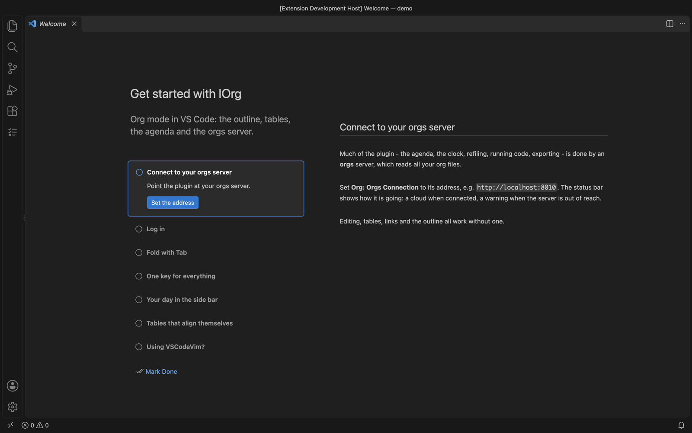

** What works on its own, and what needs the orgs server
  Editing works with nothing else: the outline, TODO keywords, tables (and
  their alignment, sorting and plotting), links, footnotes, completion,
  statistics cookies, the column view, narrowing and the decorations.

  The *orgs server* reads all your org files and does what spans files or
  runs things: the agenda, clocking, refile and archive, table formulas,
  running source blocks, exporting, capture, habits, encryption,
  attachments, history and search. It lives at
  [[https://github.com/ihdavids/orgs][github.com/ihdavids/orgs]]; start it with =orgs serve=
  in the directory with its =orgs.yaml=.

** Connecting
  Set *Org: Orgs Connection* (=org.orgsConnection=) to the server's address -
  =http://localhost:8010=, or =https://…= for one with a certificate
  (=org.allowSelfSigned= accepts a self-signed one).

  A server that wants a login asks once, and the plugin keeps you logged in.
  A server started with =noAuth: true= wants none: the plugin asks the server
  when it starts (and whenever the address changes) and skips the login.

** The status bar
  In an org file, the left of the status bar says how the server is:

  | Shows                | Means                                              |
  |----------------------+----------------------------------------------------|
  | ☁ orgs               | Connected                                          |
  | 👤 orgs: log in      | The server wants a login                           |
  | ⚠ orgs (highlighted) | The server is not answering                        |

  Click it to log in or out, check again, open worg, or change the address.
  It checks again every couple of minutes and when you come back to the
  window. In a table it also shows the cell (=@2$3=) and its formula; on the
  right, the running clock and any timer.

** Using VSCodeVim
  Everything works in insert mode. In normal mode Tab folds headings and
  moves between table cells, and Alt+H/J/K/L move headings, rows and
  columns. *Org: Set Up Vim Table Keys* adds =<leader>t…= mappings for the
  table commands. See [[*Keys][Keys]].

* Keys
    One key to remember: *Ctrl+Alt+O M* opens a menu of everything, with what
    fits where the cursor is first and each item's key beside it.

    #+CAPTION: Ctrl+Alt+O M on a heading: the heading commands first, each with its key, then everything else.
    [[./images/menu.png]]

    The keys that act on a table or a heading only take over on a table or
    heading line; everywhere else Tab, Enter and Alt+arrows are VS Code's.
    With VSCodeVim, everything here works in insert mode; the vim column is
    for normal mode.

** Everywhere in an org file
    | Key                 | Does                                       | Vim normal |
    |---------------------+--------------------------------------------+------------|
    | Ctrl+Alt+O M        | The menu                                   |            |
    | Ctrl+Alt+O R        | Run what is at the cursor                  |            |
    | Ctrl+Alt+O O        | Sort: table rows, a list, the headings under one |      |
    | Ctrl+Alt+O .        | Insert a timestamp                         |            |
    | Ctrl+Alt+O K        | Insert a link                              |            |
    | Ctrl+Alt+O Shift+K  | Store a link to here                       |            |
    | Ctrl+Alt+O Shift+O  | Open the link under the cursor             |            |
    | F12 / Ctrl+click    | Follow a link                              | =gd=       |
    | Shift+F12           | Links to this heading                      | =gr=       |
    | Ctrl+Alt+O W        | Refile the subtree                         |            |
    | Ctrl+Alt+O Shift+W  | Copy the subtree to…                       |            |
    | Ctrl+Alt+O A        | Archive the subtree                        |            |
    | Ctrl+Alt+O E        | Export the file                            |            |
    | Ctrl+Alt+O Shift+E  | Export the subtree                         |            |
    | Ctrl+Alt+O Shift+A  | Attach a file                              |            |
    | Ctrl+Alt+O Shift+F  | Search this file                           |            |
    | Ctrl+Alt+O Ctrl+I   | Clock in                                   |            |
    | Ctrl+Alt+O Ctrl+O   | Clock out                                  |            |
    | Ctrl+Alt+O Shift+N  | Narrow to the subtree                      |            |
    | Ctrl+Alt+O Shift+C  | Column view                                |            |
    | Ctrl+Alt+O Ctrl+F   | Insert a footnote / go between it and its note |        |
    | Alt+Left / Alt+Right | Cycle the TODO keyword, or step a date    |            |

** Anywhere in VS Code
    | Key           | Does                              |
    |---------------+-----------------------------------|
    | Ctrl+Alt+O F  | Search every org file             |
    | Ctrl+Alt+O J  | Go to the running clock           |
    | Ctrl+Alt+O N  | New org file                      |
    | Ctrl+Alt+O Q  | Quick capture                     |
    | Ctrl+Alt+O Shift+T | Start a timer (pomodoro)     |

** On a heading
    | Key                          | Does                                  | Vim normal       |
    |------------------------------+---------------------------------------+------------------|
    | Tab                          | Fold, show children, show all         | Tab              |
    | Shift+Tab                    | The whole file: overview, contents, all | Shift+Tab      |
    | Alt+Up / Alt+Down            | Move the subtree                      | Alt+K / Alt+J    |
    | Alt+Shift+Left / Alt+Shift+Right | Promote / demote the subtree      | Alt+H / Alt+L    |

** In a table
    | Key                          | Does                                  | Vim normal                |
    |------------------------------+---------------------------------------+---------------------------|
    | Tab / Shift+Tab              | Next / previous cell, aligning        | Tab / Shift+Tab           |
    | Enter                        | Down a row, making one at the end     | (vim's own Enter)         |
    | Shift+Enter                  | Copy the cell down                    |                           |
    | Alt+arrows                   | Move the row or column                | Alt+H/J/K/L               |
    | Alt+Shift+Down / Up          | Insert a row / delete the row         | Alt+Shift+J / Alt+Shift+K |
    | Alt+Shift+Right / Left       | Insert a column / delete the column   | Alt+Shift+L / Alt+Shift+H |
    | Ctrl+-                       | A rule below                          |                           |
    | Ctrl+Alt+O Enter             | A rule below, and on under it         |                           |
    | Ctrl+Alt+O =                 | Edit the cell's formula               |                           |
    | Ctrl+Alt+O Shift+R           | Recalculate every table               |                           |
    | Ctrl+Alt+O G                 | Plot the table                        |                           |

    *Set Up Vim Table Keys* adds =<leader>t…= mappings for the table commands
    (see [[file:tables.org][Tables]]).

** Every key binding
Every key the plugin binds, by where it works. The macOS column is the same
key written the Mac's way: =Ctrl= is ⌃, =Alt= is ⌥ (Option), =Shift= is ⇧.
Search for a key (=ctrl+alt+o=, =tab=) or for what you want to do.

*** Anywhere in VS Code
These work in any editor, org file or not.

| Key | macOS | Does | Command |
|-----+-------+------+---------|
| ~Ctrl+Alt+O F~ | ~⌃⌥O F~ | Search All Files | ~org.searchFiles~ |
| ~Ctrl+Alt+O J~ | ~⌃⌥O J~ | Go To Running Clock | ~org.jumpToClock~ |
| ~Ctrl+Alt+O N~ | ~⌃⌥O N~ | New File | ~org.newFile~ |
| ~Ctrl+Alt+O Q~ | ~⌃⌥O Q~ | Quick Capture | ~org.quickCapture~ |
| ~Ctrl+Alt+O Shift+T~ | ~⌃⌥O ⇧T~ | Start Timer | ~org.startTimer~ |

*** In an org file
These work anywhere in an org file.

| Key | macOS | Does | Command |
|-----+-------+------+---------|
| ~Alt+Left~ | ~⌥←~ | Previous Keyword Or Earlier Date | ~org.decrementContext~ |
| ~Alt+Right~ | ~⌥→~ | Next Keyword Or Later Date | ~org.incrementContext~ |
| ~Ctrl+Alt+O .~ | ~⌃⌥O .~ | Insert Timestamp | ~org.insertTimestamp~ |
| ~Ctrl+Alt+O =~ | ~⌃⌥O =~ | Edit Table Formula | ~org.editTableFormula~ |
| ~Ctrl+Alt+O A~ | ~⌃⌥O A~ | Archive Subtree | ~org.archive~ |
| ~Ctrl+Alt+O B~ | ~⌃⌥O B~ | Bold | ~org.bold~ |
| ~Ctrl+Alt+O C~ | ~⌃⌥O C~ | Code | ~org.code~ |
| ~Ctrl+Alt+O Ctrl+F~ | ~⌃⌥O ⌃F~ | Insert Footnote | ~org.insertFootnote~ |
| ~Ctrl+Alt+O Ctrl+I~ | ~⌃⌥O ⌃I~ | Clock In | ~org.clockin~ |
| ~Ctrl+Alt+O Ctrl+O~ | ~⌃⌥O ⌃O~ | Clock Out | ~org.clockout~ |
| ~Ctrl+Alt+O Ctrl+U~ | ~⌃⌥O ⌃U~ | Update Clock Total On This Line | ~org.updateclock~ |
| ~Ctrl+Alt+O D~ | ~⌃⌥O D~ | Demote Subtree | ~org.demoteSubtree~ |
| ~Ctrl+Alt+O E~ | ~⌃⌥O E~ | Export File | ~org.export~ |
| ~Ctrl+Alt+O G~ | ~⌃⌥O G~ | Plot Table | ~org.plotTable~ |
| ~Ctrl+Alt+O H~ | ~⌃⌥O H~ | Insert Heading Respect Content | ~org.insertHeadingRespectContent~ |
| ~Ctrl+Alt+O I~ | ~⌃⌥O I~ | Italic | ~org.italic~ |
| ~Ctrl+Alt+O K~ | ~⌃⌥O K~ | Insert Link | ~org.insertLink~ |
| ~Ctrl+Alt+O L~ | ~⌃⌥O L~ | Fixed Width Line | ~org.literal~ |
| ~Ctrl+Alt+O M~ | ~⌃⌥O M~ | Menu | ~org.menu~ |
| ~Ctrl+Alt+O O~ | ~⌃⌥O O~ | Sort | ~org.sort~ |
| ~Ctrl+Alt+O P~ | ~⌃⌥O P~ | Promote Subtree | ~org.promoteSubtree~ |
| ~Ctrl+Alt+O R~ | ~⌃⌥O R~ | Run At Cursor | ~org.run~ |
| ~Ctrl+Alt+O S~ | ~⌃⌥O S~ | Insert Subheading | ~org.insertSubheading~ |
| ~Ctrl+Alt+O Shift+A~ | ~⌃⌥O ⇧A~ | Attach File | ~org.attachFile~ |
| ~Ctrl+Alt+O Shift+C~ | ~⌃⌥O ⇧C~ | Column View | ~org.columnView~ |
| ~Ctrl+Alt+O Shift+D~ | ~⌃⌥O ⇧D~ | Demote Heading | ~org.doDemote~ |
| ~Ctrl+Alt+O Shift+E~ | ~⌃⌥O ⇧E~ | Export Subtree | ~org.exportSubtree~ |
| ~Ctrl+Alt+O Shift+F~ | ~⌃⌥O ⇧F~ | Search This File | ~org.searchThisFile~ |
| ~Ctrl+Alt+O Shift+K~ | ~⌃⌥O ⇧K~ | Store Link | ~org.storeLink~ |
| ~Ctrl+Alt+O Shift+N~ | ~⌃⌥O ⇧N~ | Narrow To Subtree | ~org.narrowToSubtree~ |
| ~Ctrl+Alt+O Shift+O~ | ~⌃⌥O ⇧O~ | Open Link | ~org.openLink~ |
| ~Ctrl+Alt+O Shift+P~ | ~⌃⌥O ⇧P~ | Promote Heading | ~org.doPromote~ |
| ~Ctrl+Alt+O Shift+R~ | ~⌃⌥O ⇧R~ | Recalculate All Tables In File | ~org.execAllTables~ |
| ~Ctrl+Alt+O Shift+W~ | ~⌃⌥O ⇧W~ | Copy Subtree To | ~org.copySubtree~ |
| ~Ctrl+Alt+O T~ | ~⌃⌥O T~ | Timestamp | ~org.timestamp~ |
| ~Ctrl+Alt+O U~ | ~⌃⌥O U~ | Underline | ~org.underline~ |
| ~Ctrl+Alt+O V~ | ~⌃⌥O V~ | Verbatim | ~org.verbose~ |
| ~Ctrl+Alt+O W~ | ~⌃⌥O W~ | Refile Subtree | ~org.refile~ |
| ~Ctrl+Enter~ | ~⌃↩~ | Do What I Mean | ~org.addDoWhatIMean~ |
| ~Ctrl+O A T~ | ~⌃O A T~ | org.toggleDoWhatIMean | ~org.toggleDoWhatIMean~ |
| ~Ctrl+Q Ctrl+F~ | ~⌃Q ⌃F~ | Align Table | ~org.formatUnderCursor~ |
| ~Ctrl+Q Ctrl+Q~ | ~⌃Q ⌃Q~ | Enable Table Mode | ~org.tableModeOn~ |
| ~Ctrl+Tab~ | ~⌃⇥~ | Toggle Fold | ~org.tabHandler~ |

*** On a heading
These take over only with the cursor on a heading line; elsewhere the key does what it always does.

| Key | macOS | Does | Command |
|-----+-------+------+---------|
| ~Alt+Down~ | ~⌥↓~ | Move Subtree Down | ~org.moveSubtreeDown~ |
| ~Alt+Shift+Left~ | ~⌥⇧←~ | Promote Subtree | ~org.promoteSubtree~ |
| ~Alt+Shift+Right~ | ~⌥⇧→~ | Demote Subtree | ~org.demoteSubtree~ |
| ~Alt+Up~ | ~⌥↑~ | Move Subtree Up | ~org.moveSubtreeUp~ |
| ~Shift+Tab~ | ~⇧⇥~ | Cycle Global Visibility | ~org.globalCycle~ |
| ~Tab~ | ~⇥~ | Cycle Visibility | ~org.cycle~ |

*** In a table
These take over only with the cursor on a table line (Ctrl+Q Ctrl+Q turns them off and on).

| Key | macOS | Does | Command |
|-----+-------+------+---------|
| ~Alt+Down~ | ~⌥↓~ | Move Table Row Down | ~org.moveRowDown~ |
| ~Alt+Left~ | ~⌥←~ | Move Table Column Left | ~org.moveColLeft~ |
| ~Alt+Right~ | ~⌥→~ | Move Table Column Right | ~org.moveColRight~ |
| ~Alt+Shift+Down~ | ~⌥⇧↓~ | Insert Table Row Below | ~org.addRowDown~ |
| ~Alt+Shift+Left~ | ~⌥⇧←~ | Delete Table Column | ~org.deleteCol~ |
| ~Alt+Shift+Right~ | ~⌥⇧→~ | Insert Table Column Right | ~org.addColRight~ |
| ~Alt+Shift+Up~ | ~⌥⇧↑~ | Delete Table Row | ~org.deleteRow~ |
| ~Alt+Up~ | ~⌥↑~ | Move Table Row Up | ~org.moveRowUp~ |
| ~Ctrl+-~ | ~⌃-~ | Insert Table Rule | ~org.insertSeparator~ |
| ~Ctrl+Alt+O Enter~ | ~⌃⌥O ↩~ | Insert Table Rule And Move Below | ~org.insertSeparatorAndMove~ |
| ~Ctrl+Q Ctrl+Q~ | ~⌃Q ⌃Q~ | Disable Table Mode | ~org.tableModeOff~ |
| ~Ctrl+Q Space~ | ~⌃Q Space~ | Clear Table Cell | ~org.clearCell~ |
| ~Enter~ | ~↩~ | Table Next Row | ~org.nextRow~ |
| ~Shift+Enter~ | ~⇧↩~ | Copy Table Field Down | ~org.copyFieldDown~ |
| ~Shift+Tab~ | ~⇧⇥~ | Table Previous Cell | ~org.gotoPreviousCell~ |
| ~Tab~ | ~⇥~ | Table Next Cell | ~org.gotoNextCell~ |

*** In a table, vim normal mode
With VSCodeVim, in normal mode, on a table line. In insert mode the table keys work.

| Key | macOS | Does | Command |
|-----+-------+------+---------|
| ~Alt+H~ | ~⌥H~ | Move Table Column Left | ~org.moveColLeft~ |
| ~Alt+H~ | ~⌥H~ | Promote Subtree | ~org.promoteSubtree~ |
| ~Alt+J~ | ~⌥J~ | Move Table Row Down | ~org.moveRowDown~ |
| ~Alt+J~ | ~⌥J~ | Move Subtree Down | ~org.moveSubtreeDown~ |
| ~Alt+K~ | ~⌥K~ | Move Table Row Up | ~org.moveRowUp~ |
| ~Alt+K~ | ~⌥K~ | Move Subtree Up | ~org.moveSubtreeUp~ |
| ~Alt+L~ | ~⌥L~ | Move Table Column Right | ~org.moveColRight~ |
| ~Alt+L~ | ~⌥L~ | Demote Subtree | ~org.demoteSubtree~ |
| ~Alt+Shift+H~ | ~⌥⇧H~ | Delete Table Column | ~org.deleteCol~ |
| ~Alt+Shift+J~ | ~⌥⇧J~ | Insert Table Row Below | ~org.addRowDown~ |
| ~Alt+Shift+K~ | ~⌥⇧K~ | Delete Table Row | ~org.deleteRow~ |
| ~Alt+Shift+L~ | ~⌥⇧L~ | Insert Table Column Right | ~org.addColRight~ |

*** In the calendar
In the date picker the timestamp commands open.

| Key | macOS | Does | Command |
|-----+-------+------+---------|
| ~,~ | ~,~ | org.calendar.prevDate | ~org.calendar.prevDate~ |
| ~.~ | ~.~ | org.calendar.nextDate | ~org.calendar.nextDate~ |
| ~<~ | ~<~ | org.calendar.prevWeek | ~org.calendar.prevWeek~ |
| ~>~ | ~>~ | org.calendar.nextWeek | ~org.calendar.nextWeek~ |
| ~Enter~ | ~↩~ | org.calendar.setDate | ~org.calendar.setDate~ |
| ~Esc~ | ~Esc~ | workbench.action.closeActiveEditor | ~workbench.action.closeActiveEditor~ |

*** In a TODO list
In a TODO list opened with Org: Todo View.

| Key | macOS | Does | Command |
|-----+-------+------+---------|
| ~E~ | ~E~ | org.todo.effort | ~org.todo.effort~ |
| ~Enter~ | ~↩~ | org.todo.goto | ~org.todo.goto~ |
| ~F3~ | ~F3~ | org.todo.filter | ~org.todo.filter~ |

*** On a capture page
On the page Org: Capture opens.

| Key | macOS | Does | Command |
|-----+-------+------+---------|
| ~Ctrl+Alt+Q~ | ~⌃⌥Q~ | org.capture.escape | ~org.capture.escape~ |
| ~Ctrl+Alt+W~ | ~⌃⌥W~ | org.capture.close | ~org.capture.close~ |

* The outline
    Headings are the shape of an org file. These keys work on the heading the
    cursor is on; they only take over on a heading line, so elsewhere Tab and
    Alt+Up do what they always do.

** Showing and hiding

    #+CAPTION: Shift+Tab, twice: every heading showing, the text under them folded away.
    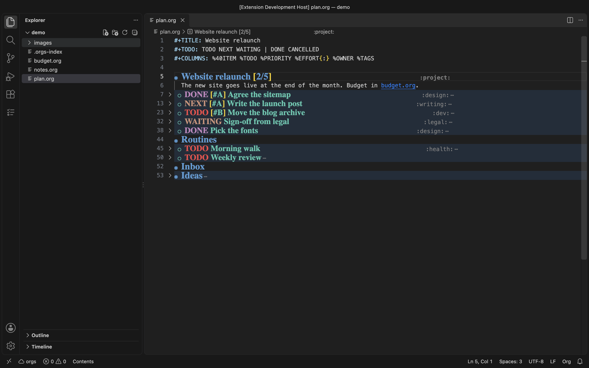

    | Key       | Does                                                                   |
    |-----------+------------------------------------------------------------------------|
    | Tab       | On a heading: folded, then its children, then everything under it      |
    | Shift+Tab | On a heading: the whole file - top headings, then every heading, then all |

    Drawers (=:PROPERTIES:=, =:LOGBOOK:=) stay folded as you open things up,
    as org keeps them. VS Code's own folding keys work too (and =za=, =zc=,
    =zo= in vim).

** Moving and reshaping
    | Key                         | Does                                              |
    |-----------------------------+---------------------------------------------------|
    | Alt+Up / Alt+Down           | Move the subtree past the heading before or after it |
    | Alt+Shift+Left / Alt+Shift+Right | Promote or demote the subtree               |
    | Alt+Left / Alt+Right        | Cycle the TODO keyword, or step a date under the cursor |

    A subtree moves with everything under it; blank lines stay where they
    were in the layout, so the spacing between entries does not change.

** Sorting
    *Sort* (Ctrl+Alt+O O) sorts whatever the cursor is in:

    - *on or under a heading*: the headings under it - alphabetically, by TODO
      state (in your keyword order), by priority, by scheduled or deadline
      date, or numerically. The text above the first child stays put.
    - *in a list*: its items, with the lines under each, alphabetically,
      numerically, or checked/unchecked first. A numbered list is numbered
      again.
    - *in a table*: its rows by the cursor's column (see [[file:tables.org][Tables]]).

** With vim
    In normal mode Tab and Shift+Tab cycle as above, and on a heading:

    | Key           | Does                         |
    |---------------+------------------------------|
    | Alt+K / Alt+J | Move the subtree up / down   |
    | Alt+H / Alt+L | Promote / demote the subtree |

** Narrowing
    *Narrow To Subtree* (Ctrl+Alt+O Shift+N) opens the subtree the cursor is in
    in a tab of its own - org's =C-x n s=. It is an org document like any
    other: tables, links and completion all work. Saving it writes the
    subtree back into its file and saves the file; changes made to the file
    show up in it. Close the tab to widen. (Commands that go through the orgs
    server - refile, clock, run - work from the whole file.)

    #+CAPTION: A subtree narrowed into its own tab. Saving it writes it back into plan.org.
    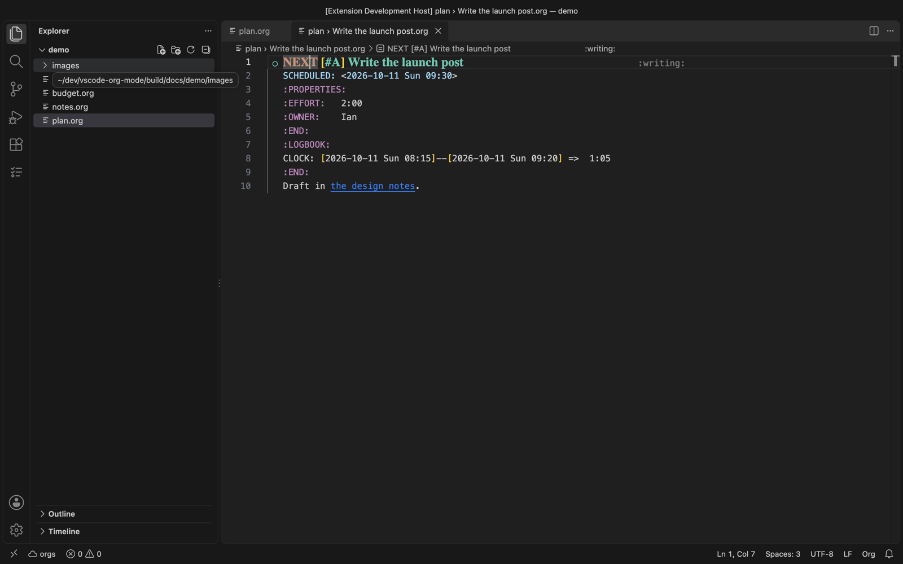

** Statistics cookies
    Put =[/]= or =[%]= on a heading and it keeps count: =[2/5]=, =[40%]=. It
    counts the keywords of the headings directly under it (how many are
    done), or, with none of those, the checkboxes in its own entry. It
    updates as you change a keyword or tick a box, in the same undo step.
    =org.autoStatistics= turns it off; *Update Statistics Cookies* does it by
    hand.

* Tables
    Type a table the way you would write one by hand and press Tab: it is
    aligned and the cursor moves on.

    #+BEGIN_EXAMPLE
    |Item|Qty|Price      Tab        | Item  | Qty | Price |
    |-                    ===>       |-------+-----+-------|
    |apple|3|1.50                    | apple |   3 |  1.50 |
    #+END_EXAMPLE

    Columns that are mostly numbers line up on the right, as org has them.
    Link markup that the editor hides does not count towards a column's width.

** Moving about
    | Key         | Does                                                          |
    |-------------+---------------------------------------------------------------|
    | Tab         | Align and go to the next cell; past the last cell, a new row |
    | Shift+Tab   | Align and go to the previous cell                             |
    | Enter       | Down a row in the same column; a new row over a rule or at the end |
    | Shift+Enter | Copy the cell down (an empty cell takes the one above); numbers count up |

    Tab on a line typed as =|-= turns it into a full rule.

** Changing the shape
    | Key                         | Does                                   |
    |-----------------------------+----------------------------------------|
    | Alt+Up / Alt+Down           | Move the row                           |
    | Alt+Left / Alt+Right        | Move the column                        |
    | Alt+Shift+Down              | Insert a row below                     |
    | Alt+Shift+Up                | Delete the row                         |
    | Alt+Shift+Right             | Insert a column to the right           |
    | Alt+Shift+Left              | Delete the column                      |
    | Ctrl+-                      | A rule under the row                   |
    | Ctrl+Alt+O Enter            | A rule under the row, and on below it  |
    | Ctrl+Q Ctrl+F               | Align                                  |
    | Ctrl+Q Space                | Clear the cell                         |
    | Ctrl+Q Ctrl+Q               | Turn table keys off (and on again)     |

    Everything else is in the table menu, *Ctrl+Alt+O M*: split a cell onto a
    new row, join the row below, sort, transpose, sum a column, plot, import,
    and more. Type to filter it.

** Alignment and width cookies
    A row of cookies sets how each column sits and how wide it shows:

    #+BEGIN_EXAMPLE
    | <c>  | <r> | <12>                              |
    | Name | Age | Notes                             |
    #+END_EXAMPLE

    =<l>=, =<r>= and =<c>= align a column. =<N>= shows the column N
    characters wide: what does not fit is hidden and ends in an ellipsis,
    until the cursor is in the cell. =<r8>= does both.

** Formulas
    Formulas live on the =#+TBLFM:= line under the table and are worked out
    by the orgs server. Recalculating sends the table as it reads in the
    editor - unsaved changes too - and puts the answer back, so it is one undo
    and needs no save.

    #+CAPTION: The cursor in a cell worked out by a formula: the formula is outlined on the #+TBLFM: line, the status bar shows the cell and its formula, and hovering says the same with links to edit it or recalculate.
    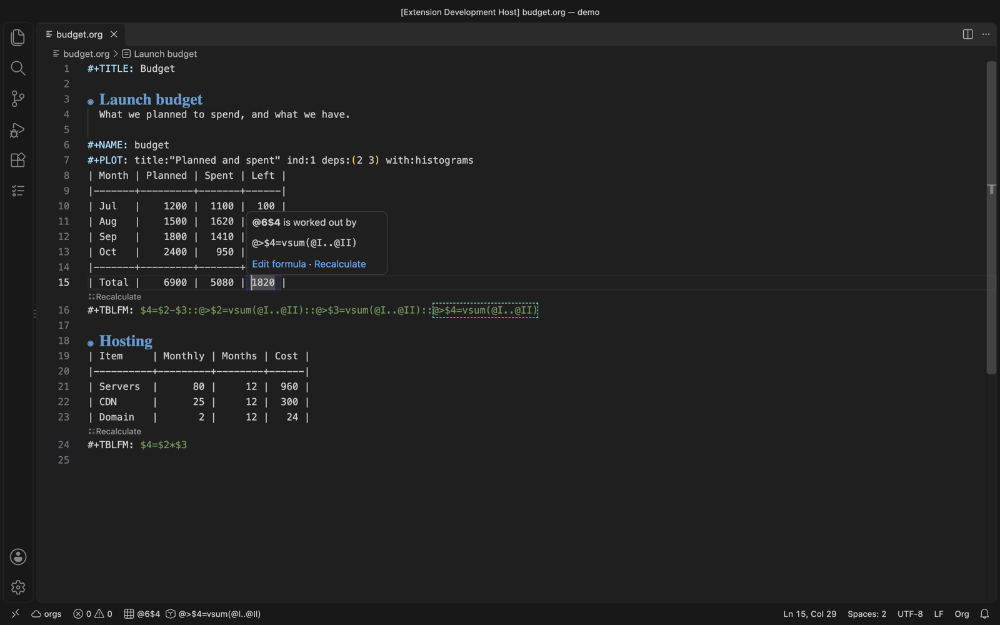

    | Key                | Does                                            |
    |--------------------+-------------------------------------------------|
    | Ctrl+Alt+O R       | Recalculate the table                           |
    | Ctrl+Alt+O Shift+R | Recalculate every table in the file             |
    | Ctrl+Alt+O =       | Edit the formula for the cell under the cursor  |

    - With the cursor in a cell, the status bar shows the cell's reference
      (=@3$2=) and the formula that fills it; hovering shows it too. The cells
      that formula writes are outlined.
    - Type =$1*2= after an === in a cell (=$1*2) and press Tab: it becomes a
      formula for the whole column. =:== makes one for that cell alone.
    - =highlight($3, "red")=, =red($3)=, =green($3)= ... and
      =gradient($2, $2, "red", "yellow", "green")= colour the cells they fill
      after a recalculation. The colours go when the table is next changed.
    - =org.tableAutoRecalc=: ="marked"= (the default) recalculates when Tab
      or Enter leaves a row with =#= in its first column, as org does;
      ="always"= on every Tab and Enter; ="off"= only when asked.
    - =org.tableRecalcOnSave= recalculates every table when the file is saved.

    Recalculating needs a reachable orgs server you are logged in to.

** Making tables
    - *Create Table*: a header, a rule and empty rows, sized as you ask.
    - *Convert Selection To Table*: the selection, or the paragraph the
      cursor is in, split on tabs, commas, semicolons or runs of spaces. A
      first row of words over rows of numbers gets a rule under it.
    - *Paste As Table* and *Import CSV As Table* do the same with the
      clipboard or a file.

** Finding tables
    - *Go To Table* lists every table the orgs server knows, with its name,
      heading, size and formula count (this file's tables without a server).
    - *Insert Table Name* inserts a =#+NAME:= for =remote(name, @2$3)=.

** Sorting, turning, adding up
    - *Sort Table Rows* (Ctrl+Alt+O O) sorts the rows between the rules
      around the cursor by its column: alphabetical, numeric or by date, either
      way. The likely one is offered first.
    - *Transpose Table* turns rows into columns.
    - *Sum Table Column* adds up the column (or the selected rows of it) and
      copies the total. Times like =1:30= add up as times.

** Plotting
    *Plot Table* (Ctrl+Alt+O G) opens a chart beside the editor that follows
    the table as you edit it. Without anything else, the first column of words
    is the x axis and the columns of numbers are the series: words give bars,
    numbers and dates give lines, and times plot as hours. An org-plot line
    above the table says otherwise:

    #+CAPTION: A table and its chart. The chart follows the table as it changes; Table shows the numbers, Save SVG keeps a copy.
    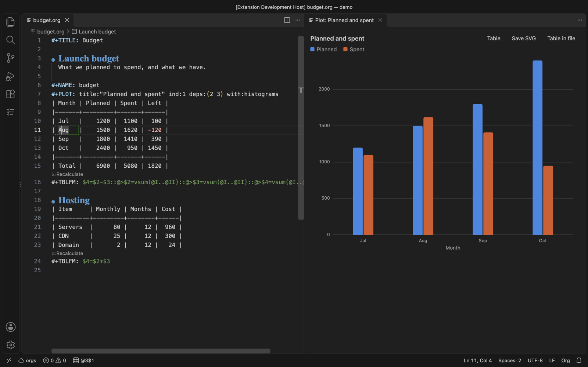

    #+BEGIN_EXAMPLE
    #+PLOT: title:"Sales" ind:1 deps:(2 3) with:histograms
    #+END_EXAMPLE

    =with:lines=, =points= and =histograms= pick lines, dots and bars. The
    chart has a table view and saves as svg.

** Vim
    The table keys work with VSCodeVim. In insert mode everything above works
    as it does without vim. In normal mode Tab and Shift+Tab move between
    cells, Enter keeps its vim meaning, and:

    | Key                         | Does                                          |
    |-----------------------------+-----------------------------------------------|
    | Alt+H / J / K / L           | Move the column left, the row down or up, the column right |
    | Alt+Shift+J / Alt+Shift+K   | Insert a row below / delete the row           |
    | Alt+Shift+L / Alt+Shift+H   | Insert a column right / delete the column     |

    *Set Up Vim Table Keys* adds leader mappings to your vim settings:
    =<leader>tt= opens the table menu, =<leader>tr= recalculates,
    =<leader>t== edits a formula, =<leader>ts= sorts, =<leader>t-= adds a
    rule, =<leader>to= / =<leader>tO= add a row below / above,
    =<leader>td= deletes a row, =<leader>ti= / =<leader>tx= add / delete a
    column, =<leader>tp= plots and =<leader>tc= converts to a table. Keys
    you have already mapped are left alone.

* Links
    Links are VS Code's own navigation. Nothing new to learn: the keys you use
    for code work on links.

    #+CAPTION: Hovering an image link shows the picture.
    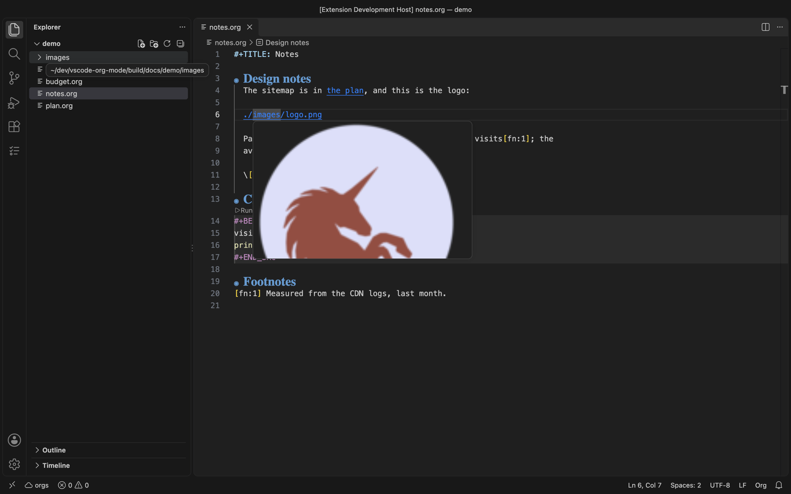

    | Key                           | Does                                                  |
    |-------------------------------+-------------------------------------------------------|
    | F12, Ctrl+click (=gd= in vim) | Follow the link under the cursor                      |
    | Shift+F12 (=gr= in vim)       | On a heading: every link to it, from every org file   |
    | Hover                         | An image link shows the picture; a link to a heading shows the heading |
    | Ctrl+Alt+O K                  | Insert a link                                         |
    | Ctrl+Alt+O Shift+K            | Store a link to where you are                         |
    | Ctrl+Alt+O Shift+O            | Open the link under the cursor (urls in the browser)  |

** What links point at

    #+CAPTION: Shift+F12 on a heading: every link to it, from every org file, in VS Code's references view.
    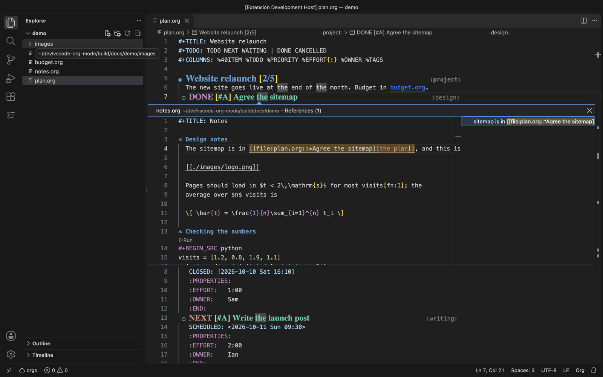

    | Link                               | Goes to                                          |
    |------------------------------------+--------------------------------------------------|
    | =[[*Heading]]=                     | The heading with that title in this file         |
    | =[[#custom-id]]=                   | The heading with that =:CUSTOM_ID:=              |
    | =[[id:5f2c…]]=                     | The heading with that =:ID:=, in any file        |
    | =[[file:notes.org]]=               | Another file                                     |
    | =[[file:notes.org::*Heading]]=     | A heading in another file (also =::#id=, =::42= for a line) |
    | =[[target]]=                       | A =<<target>>=, else a heading of that name, else the text |
    | =[[https://…]]=, =mailto:=         | Opened outside VS Code                           |
    | =[[./pics/cat.png]]=               | An image: hover to see it                        |

    An =id:= that is not in the workspace is asked of the orgs server.

** Making links
    *Insert Link* offers every heading in the workspace - this file's first -
    plus "a web address…" and "a file…". Type to find a heading anywhere.
    It links by =:ID:= when the heading has one, by =:CUSTOM_ID:= next, by
    title otherwise, and asks for a description (empty for none). With text
    selected, that text is the description.

    #+CAPTION: Insert Link offers every heading in the workspace - type to find one.
    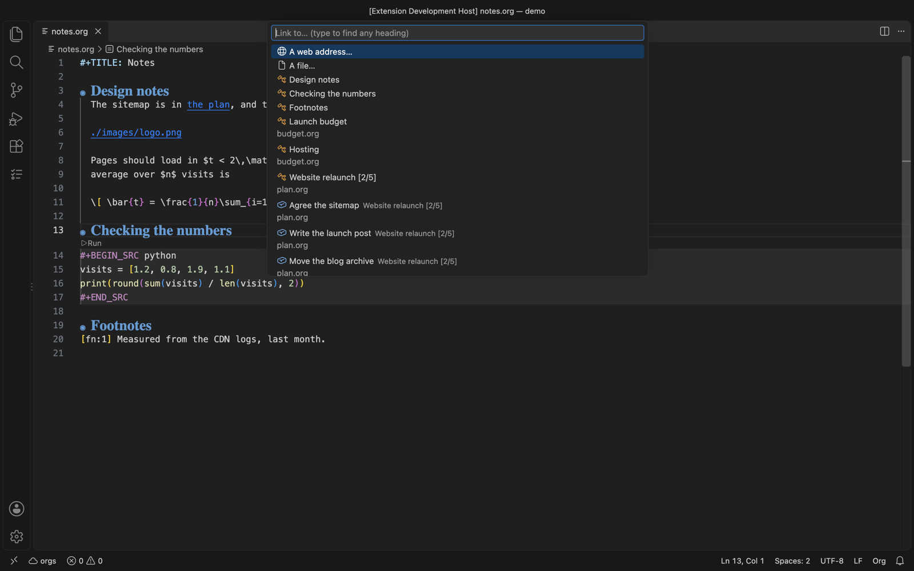

    *Store Link* remembers the heading you are under; Insert Link then offers
    it first, from any file, with the right relative path. The link also goes
    on the clipboard.

    Typing =[[= offers the headings, custom ids and targets of this file and
    the workspace's other org files (see [[file:completion.org][Completion]]).

    For a link that survives the heading being renamed or moved, give it an
    ID first: *Insert ID* (see [[file:dates.org][Dates and properties]]).

* Completion
    Suggestions come up as you type, from this file first, then the
    workspace, then the orgs server (every tag and property it knows) when you
    are logged in.

    #+CAPTION: Typing a colon at the end of a heading offers the tags the file uses most, then the ones the orgs server knows.
    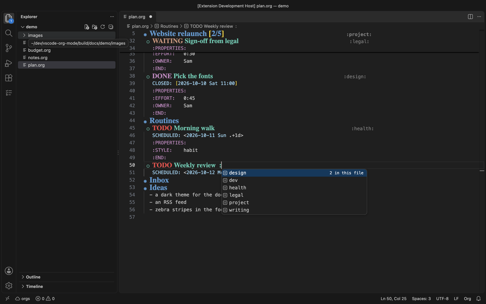

    | Where you type                          | You are offered                               |
    |-----------------------------------------+-----------------------------------------------|
    | after the stars of a heading            | TODO keywords - yours, and the file's =#+TODO:= |
    | after a =:= at the end of a heading     | Tags, the ones used most first; pick one and the next is offered |
    | =#+= at the start of a line             | Keywords; =BEGIN_SRC=, =BEGIN_QUOTE=... come with their =#+END= |
    | after =#+BEGIN_SRC=                     | Languages, the ones this file uses first      |
    | =:= in a =:PROPERTIES:= drawer          | Property names                                |
    | after =:NAME:= in a drawer              | That property's values, from everywhere       |
    | after =[[=                              | Headings, custom ids and targets, and other org files |

    Lower case =#+begin_src= gives lower case keywords.

* Dates and properties
** Timestamps
    *Insert Timestamp* (Ctrl+Alt+O .) offers, in one list:

    #+CAPTION: Insert Timestamp: today or now, active or inactive, or from the calendar.
    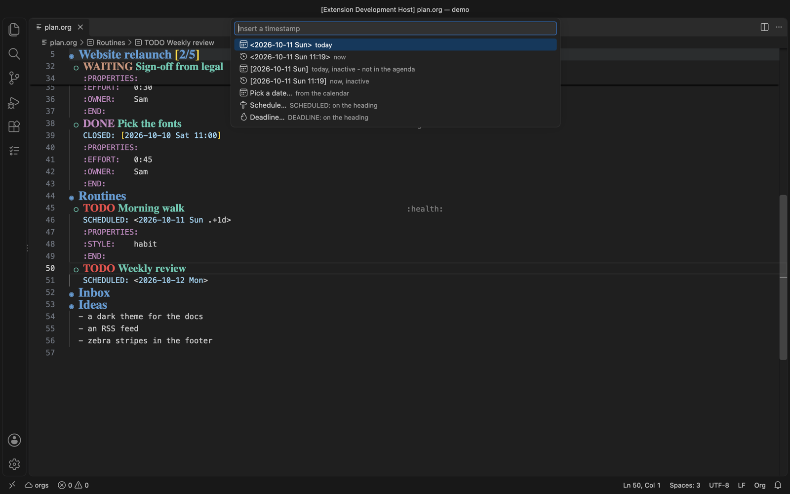

    | Choice                 | Inserts                                     |
    |------------------------+---------------------------------------------|
    | today                  | =<2026-10-11 Sun>= - shows in the agenda    |
    | now                    | =<2026-10-11 Sun 14:05>=                    |
    | today, inactive        | =[2026-10-11 Sun]= - a note of when, kept out of the agenda |
    | now, inactive          | =[2026-10-11 Sun 14:05]=                    |
    | Pick a date…           | From the calendar                           |
    | Schedule… / Deadline…  | =SCHEDULED:= or =DEADLINE:= on the heading, from the calendar |

    With the cursor on a date, Alt+Left and Alt+Right step it a day.

** Properties
    These go in the heading's =:PROPERTIES:= drawer, which is made (under any
    =SCHEDULED:= line, as org has it) when there is none:

    | Command                 | Adds                                                     |
    |-------------------------+----------------------------------------------------------|
    | Insert Created Property | =:CREATED: [2026-10-11 Sun 14:05]=, if it is not there already |
    | Insert Custom ID        | =:CUSTOM_ID:= made from the title, unique in the file - for =[[#id]]= links and html anchors |
    | Insert ID               | =:ID:= a uuid - =[[id:…]]= links find the heading wherever it moves |

    Typing =:= in a drawer offers property names, and their values after them
    (see [[file:completion.org][Completion]]).

* Footnotes
    #+CAPTION: Hovering a footnote reference shows the note.
    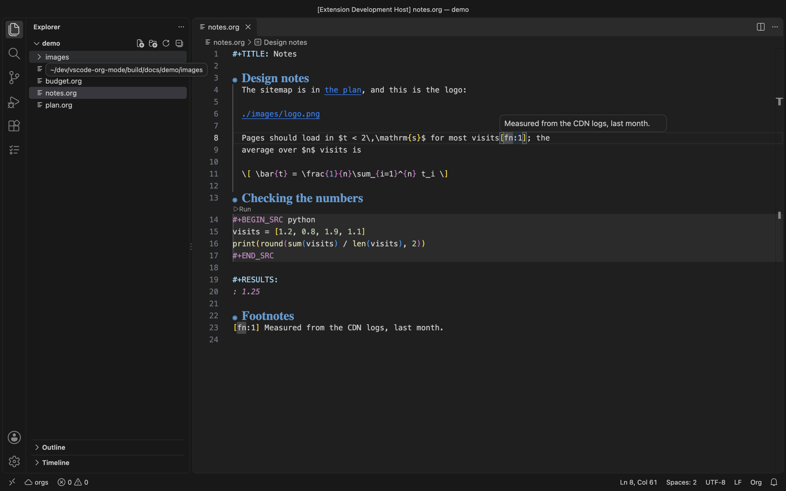

    | Key / command                 | Does                                                   |
    |-------------------------------+--------------------------------------------------------|
    | Ctrl+Alt+O Ctrl+F             | Insert the next numbered footnote, and go and write it. On a footnote: go between it and its definition |
    | F12 (=gd=) on =[fn:1]=        | Go to the definition                                   |
    | Shift+F12 (=gr=)              | Every reference to the footnote                        |
    | Hover                         | The note's text                                        |
    | Type =[fn:=                   | The labels in use, with the start of each note         |

    A new footnote's definition goes at the end of the =* Footnotes= heading,
    which is made at the end of the file when there is none. Inline notes
    (=[fn:label:the text]=) and anonymous ones (=[fn::the text]=) show on
    hover too.

* Column view
    *Column View* (Ctrl+Alt+O Shift+C) shows the file's headings as rows and
    their keyword, priority, properties and tags as columns, beside the
    editor - and you can edit any cell.

    #+CAPTION: The column view beside the file: keyword, priority, effort, owner and tags, with each heading's effort totalled from what is under it.
    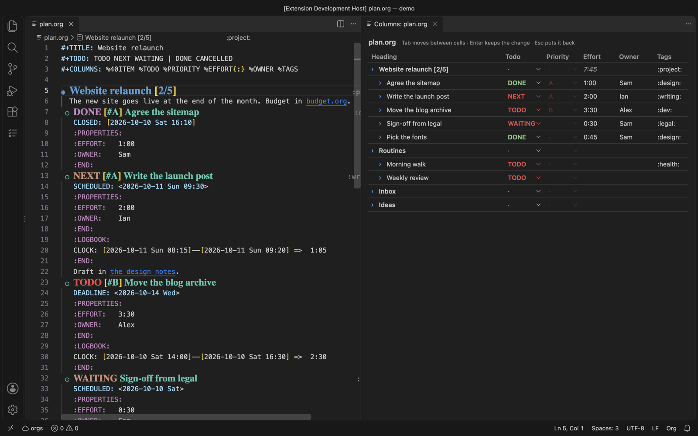

    - The columns are the file's =#+COLUMNS:= line's:
      #+BEGIN_SRC org
      #+COLUMNS: %40ITEM %TODO %PRIORITY %EFFORT(Estimate){:} %OWNER %TAGS
      #+END_SRC
      Without one: heading, state, priority, effort, the properties the file
      uses most, and tags.
    - A column summed with ={:}= (times like =1:30=) or ={+}= (numbers) shows
      each heading the total of the headings under it, in grey where the
      heading has no value of its own. Effort is summed by default.
    - Tab moves between cells; Enter (or leaving the cell) keeps a change,
      Escape puts it back. State and priority are lists to pick from.
      Emptying a property cell takes the property out.
    - The › beside a heading goes to it.

    Edits go straight into the document - one undo each, no server needed -
    and the view follows the org file you are in.

* Previews and panels
** Web page and slides
    *Show Web*, *Show Reveal JS* and *Show Impress JS* preview the file the way
    the orgs server exports it, beside the editor. The preview follows the
    org file you are in, as Markdown's preview does, and redraws when you
    save - keeping where you had scrolled to. Press =s= in it to save the page
    as html. See [[file:export.org][Exporting]] to write the files instead.

    #+CAPTION: The file previewed as a web page, beside it.
    [[./images/preview.png]]

** Gantt chart and mind map
    *Show Gantt* and *Show Mind Map* draw the headings a query finds: one of the
    named queries in =org.gantts=, or one you type. They redraw when an org
    file is saved. Worg has fuller versions (*Show Gantt Chart*, *Show Mind
    Map*).

** Pictures and maths
    *Show Pictures And Maths* opens a panel that follows the subtree the cursor
    is in and shows its linked images and its LaTeX - =$e=mc^2$=, =\(…\)=,
    =\[…\]=, =$$…$$= and =\begin{equation}…= - typeset with KaTeX. Click one to
    go to it. VS Code cannot draw pictures inside the text; this is the next
    best thing. (Hovering an image link shows it too - see [[file:links.org][Links]].)
    The maths needs a network connection the first time, to fetch KaTeX.

    #+CAPTION: The pictures and maths of the subtree the cursor is in, drawn beside the text.
    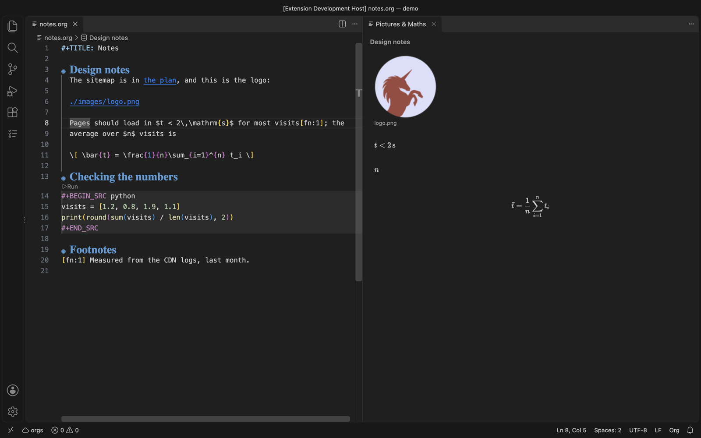

** Column view
    See [[file:column-view.org][Column view]].

* The agenda
    The *Org* icon in the activity bar opens the agenda: today, and the days
    after it (=org.agendaDays=, a week by default), from the orgs server.

    #+CAPTION: The agenda and the Clock view in the Org side bar: today with what is overdue, the week ahead, and where the time went.
    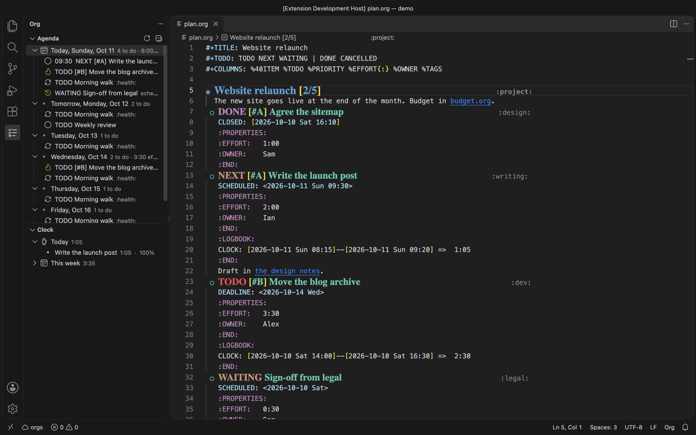

    - Today carries what is overdue, as org's agenda does: a scheduled task
      not done shows as "scheduled 2d ago", a deadline coming up as "due in
      3d", one gone by in red.
    - Each entry shows its time, keyword, priority, title, effort and tags.
      Hover for the headings above it and its file.
    - Each day says how much there is to do, and the effort it adds up to.
    - Days after today with nothing on them are left out.

** Acting on an entry
    | Do                       | To                                         |
    |--------------------------+--------------------------------------------|
    | Click it                 | Go to it                                   |
    | The ✓ button on it       | Mark it done                               |
    | The ▶ button on it       | Clock in on it                             |
    | Right-click (Shift+F10)  | Change state…, Set priority…, Set effort…, Reschedule…, Clock in |

    Reschedule offers today, tomorrow, next Monday, a week from now, or a
    date you type. The server makes each change in the file, so the agenda
    and the file always agree; the agenda refreshes itself when you save an
    org file, every few minutes, and with its refresh button.

    The keyboard works throughout: arrows to move, Enter to go to an entry,
    Shift+F10 for its menu.

    The full agenda - weeks, filters, the timeline - is worg's: *Show Agenda*.

* Clocking
    The orgs server keeps the clock: one runs at a time, wherever you started
    it - here, in worg, or on the command line - and the time goes in the
    heading's =:LOGBOOK:= drawer.

    | Key / command                 | Does                                                  |
    |-------------------------------+-------------------------------------------------------|
    | Ctrl+Alt+O Ctrl+I             | Clock in on the heading the cursor is under (clocking out of any other) |
    | Ctrl+Alt+O Ctrl+O             | Clock out                                             |
    | Ctrl+Alt+O J                  | Go to the heading the clock is running on             |
    | Update All Clock Totals       | Work out every =CLOCK:= line's total in the file again |
    | Ctrl+Alt+O Ctrl+U             | The same for the line under the cursor                |

    While the clock runs, the status bar shows how long and on what -
    =⏱ 0:42 Write the report= - and a click takes you there. It notices a clock
    started or stopped elsewhere within a couple of minutes.

    A clocked heading reads:

    #+BEGIN_SRC org
    ** Write the report
       :LOGBOOK:
       CLOCK: [2026-10-11 Sun 15:38]--[2026-10-11 Sun 16:20] =>  0:42
       :END:
    #+END_SRC

    The drawer is set on the server (=clockIntoDrawer=, =LOGBOOK= by default).

** Where the time went
    The *Clock* view, under the agenda in the Org side bar, lists today's and
    this week's clocked time by heading - most first, with each one's share.
    Click a heading to go to it.

** A focus timer
    *Start Timer* (Ctrl+Alt+O Shift+T) runs a pomodoro (25 minutes), a long
    one (50), or a time of your own, in the status bar. Started under a
    heading, it clocks in there and out again when the time is up
    (=org.pomodoroClocks= turns that off); then it offers a 5 or 15 minute
    break, or another round on the same heading. Click it to pause, add five
    minutes or stop.

    #+CAPTION: A pomodoro running: the timer, and the clock it started, on the right of the status bar.
    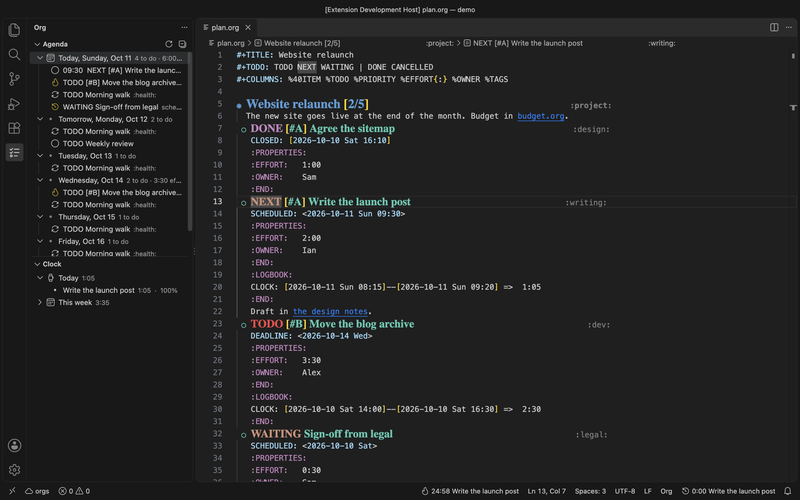

** The clocktable
    A clocktable is a dynamic block that sums the clocked time:

    #+BEGIN_SRC org
    #+BEGIN: clocktable :scope file :maxlevel 3
    #+END:
    #+END_SRC

    Put the cursor in it and Run (Ctrl+Alt+O R), or click its *Update* link
    (see [[file:running-code.org][Running code]]).

* Running code
    One key runs whatever the cursor is on: *Ctrl+Alt+O R*.

    #+CAPTION: A source block with its Run link, and its results written under it.
    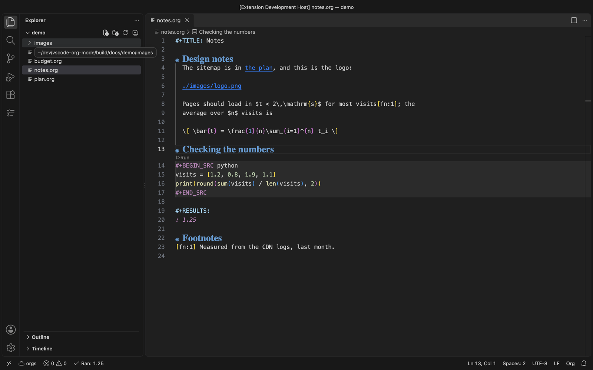

    | The cursor is in                         | Run does                                      |
    |------------------------------------------+-----------------------------------------------|
    | a table, or its =#+TBLFM:= line          | Recalculates it (see [[file:tables.org][Tables]]) |
    | a =#+BEGIN_SRC= block                    | Runs it and writes =#+RESULTS:= under it       |
    | a =#+CALL:= line                         | Runs the named block it calls                  |
    | a line with =src_python{…}= or =call_x()= | Runs the inline code, results after it        |
    | a =#+BEGIN:= dynamic block               | Refreshes it (a clocktable, a column view...)  |

    Small *Run*, *Update* and *Recalculate* links sit above blocks, calls and
    formula lines; click them instead. =org.blockCodeLens= turns them off.

    | Command                        | Does                                         |
    |--------------------------------+----------------------------------------------|
    | Run All Blocks In File         | Every block, call and inline code, top to bottom |
    | Update All Dynamic Blocks      | Every =#+BEGIN:= block in the file           |
    | Tangle File                    | Writes out each block with a =:tangle= header, and offers to open the result |

    The orgs server does the running, from the file on disk, so the file is
    saved first; the results appear as soon as the server has written them.
    A source block above with =:tangle= gets a *Tangle file* link too.

** Turning it on
    Running source blocks is off on a new orgs server, because a source block
    is a program. Turn it on, for the languages you want, in its yaml:

    #+BEGIN_SRC yaml
    babel:
      enable: true
      languages: ["python", "sh"]
    #+END_SRC

    Until then Run says so, rather than failing quietly. Dynamic blocks and
    tables need nothing turned on.

* Refiling and archiving
    #+CAPTION: Refile offers every heading the orgs server can file under, with the headings above it and its file.
    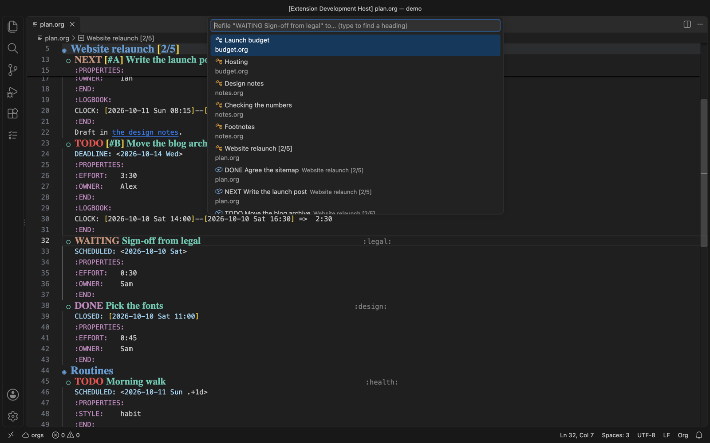

    | Key                | Does                                                         |
    |--------------------+--------------------------------------------------------------|
    | Ctrl+Alt+O W       | Refile the subtree under any heading (or a file's top level) |
    | Ctrl+Alt+O Shift+W | Copy the subtree there, leaving it where it is too           |
    | Ctrl+Alt+O A       | Archive the subtree                                          |
    |                    | *Archive All Done*: every finished subtree in the file, after asking |

    Refile and Copy offer every heading the orgs server can file under -
    type to find one; each shows the headings above it and its file. Each
    file's top level is offered too, for filing at its end.

    *Several at once:* select across several headings and Refile, Copy or
    Archive takes them all (a heading inside another selected one goes with
    its parent). The server finds them all before it moves any, so nothing
    is lost to lines moving under it.

    Archive sends a subtree where its =:ARCHIVE:= property, or the file's
    =#+ARCHIVE:= line, says - by default =<file>.org_archive= - with the time,
    its old place and its state noted on it, as org does.

    The orgs server does the moving, so the file is saved first; the editor
    shows the result as soon as the server has written it.

* Capture
    Capture has as its primary goal of getting it out of your mind now.
    When you capture you are grabbing a concept and quickly putting it in your inbox 
    for later refiling. Orgs and vscode make this possible through a hybrid approach.
    Orgs does the capture operation while vscode handles the text input.

    The orgs server allows you to define capture targets in its configuration file.
    These are synced with your vscode settings file automatically. Your vscode settings file
    then allows you to extend these capture targets with a snippet template to use when 
    filling out one of these captures. These snippets use the normal vscode snippet rules:

    As an example, variables should work just fine:
    [[https://code.visualstudio.com/docs/editor/userdefinedsnippets][VsCode Snippet Rules]] 

    Capture targets are stored in the selector section of your vscode capture definition.
    #+BEGIN_SRC json
        "todo": {
            "type":     "entry",
            "snippet":  "* ${1:HEADING}\n  [$CURRENT_YEAR $CURRENT_MONTH $CURRENT_DATE $CURRENT_HOUR:$CURRENT_MINUTE]\n   ${2:BODY}",
            "selector": "orgs_capture_target_name",
        },
    #+END_SRC

    Orgs will automatically create entries for all targets is has defined in your settings. This can get in the way
    if you don't want them but do not want to regenerate them. To fix that use the hide: true field to remove it
    as an active option for captures in your vscode settings.

** Quick capture
    *Ctrl+Alt+O Q*, from anywhere in VS Code: pick a capture template (the one
    you used last comes first), type one line, Enter. It is filed by the orgs
    server and you carry on where you were - no capture page opens. Use the
    full capture (*Org: Capture*) when you want a body, tags or a snippet.

** Capture Targets

    Capture targets specify where the new entry should go. They are used for captures, refiles and archiving.
    Captures targets come in a variety of types.

    TARGET TYPES
    - file              "path/to/file"                               - Text will be placed at the beginning or end of that file.
    - id                "id of existing org entry"                   - Filing as child of this entry, or in the body of the entry.
    - customid          "customid of existing org entry"             - Filing as child of this entry, or in the body of the entry.
    - file+headline     "filename" "node headline"                   - Fast configuration if the target heading is unique in the file.
    - file+olp          "filename" "Level 1 heading" "Level 2" ...   - For non-unique headings, the full path is safer.
    - file+regexp       "filename" "regexp to find location"         - Use a regular expression to position point.
    - file+datetree     "filename" root                              - This target creates a root datetree for today’s date.
    - file+olp+datetree "filename" [ "Level 1 heading" ...]          - This target creates a heading in a date tree for today’s date. If the optional outline path is given, the tree will be built under the node it is pointing to, instead of at top level. Check out the :time-prompt and :tree-type properties below for additional options.
    - clock                                                          - insert at position of active clock
    - hash              dynamically assigned hash                    - during a run of the server nodes are dynamically assigned a hash

** Capture Types
    Capture come in a variety of types. Types define the type of org mode component you are inserting.
    The simplest is entry in that your are capturing a full heading and body.

    - entry - This is a subnode of whatever the target it pointing at.
    - plain - This is plain text added somewhere in the node.
    - item  - this is a list item added to the end of a list in the target.
    - checkitem - this is a checkbox list item added to the end of a checklist in the target (or end of target)
    - table-line - This is a line of a table added to whatever table is in the document

** Refile
    Many organization methodologies have the concept of an inbox and one or more triage stages of the process.
    Org supports these notions through capture and refile. Once captured you can then, later, place the information
    where you need it by refiling it. Refiling simply moves the data to a more appropriate location.

    The org.refile command will refile the subtree under your cursor to a target of your choosing. Refile targets are determined
    in one of several ways:

    The global option in the orgs configuration file determines the generic search path. This is a list of org files.
    Here we are searching every org file in our entire org setup for refile targets:

    #+BEGIN_SRC js
     "refileTargets": [".*\\.org"]
    #+END_SRC

** Archive
    Some methodologies make use of the concept of a reference. There are numerous ways of handling a reference. Refiling can be 
    made to support reference material. The other is the use of an archive. Org has 2 ways that you can archive files:

    - Placing an ACHIVE tag on a heading or filetags. This removes it from consideration for the agenda amoung other things.
    - Moving the heading from the current file to a refile target. Refile targets are determined programmatically through the use of
      an #+ARHIVE: comment. This is a filename and heading combination:

      #+BEGIN_SRC org
      #+ARCHIVE: %s_done::* My Heading
      #+END_SRC

    This will move from the current file to <currentfile>.org_done under a * My Heading parent heading.
	
    When the filename is omitted, archiving happens in the same file.
	%s in the filename will be replaced by the current file
	name (without the directory part). Archiving to a different file
	is useful to keep archived entries from contributing to the
	Org-mode Agenda.
	
	The archived entries will be filed as subtrees of the specified
	headline. When the headline is omitted, the subtrees are simply
	filed away at the end of the file, as top-level entries. Also in
	the heading you can use %s to represent the file name, this can be
	useful when using the same archive for a number of different files.

    The default archive behaviour is as follows and can be configured in the
    Org Yaml file as follows

    #+BEGIN_SRC js
	"archiveDefault": "%s_archive::"
    #+END_SRC

*** New Archive File
    If a new archive file is created it will use a template for generating the archive file:

    #+BEGIN_SRC js
	"newFileTemplate": "newfile.tpl"
    #+END_SRC

    You can configure this to have the file headings you would like in your archive file.

*** Archive Properties

    Archiving will automatically add some standard properties to a heading as it is archived:
      
	file from where the entry came, its outline path the archiving time
	org-archive-save-context-info
	Parts of context info that should be stored as properties when archiving.
	When a subtree is moved to an archive file, it loses information given by
	context, like inherited tags, the category, and possibly also the TODO
	state (depending on the variable `org-archive-mark-done').
	This variable can be a list of any of the following symbols:

	- time       The time of archiving.
	- file       The file where the entry originates.
	- ltags      The local tags, in the headline of the subtree.
	- itags      The tags the subtree inherits from further up the hierarchy.
	- todo       The pre-archive TODO state.
	- category   The category, taken from file name or #+CATEGORY lines.
	- olpath     The outline path to the item.  These are all headlines above
	             the current item, separated by /, like a file path.
	
	For each symbol present in the list, a property will be created in
	the archived entry, with a prefix \"ARCHIVE_\", to remember this
	information."

    #+BEGIN_SRC js
	"archiveSaveContextInfo": ["time", "file"]
    #+END_SRC

	If true empty properties in the ArchiveSaveContextInfo are not included
	in the archive output, false all listed properties will be included even if
    empty.

    #+BEGIN_SRC js
	"archiveSkipEmptyProperties": true
    #+END_SRC

* Exporting
    | Key                | Does                                               |
    |--------------------+----------------------------------------------------|
    | Ctrl+Alt+O E       | Export the file                                    |
    | Ctrl+Alt+O Shift+E | Export just the subtree the cursor is in           |

    Pick a format - only those the orgs server has exporters for are offered -
    and the result is written next to the org file, with buttons to open it
    or show it in Finder:

    | Format             | Writes                     |
    |--------------------+----------------------------|
    | HTML               | =notes.html=               |
    | PDF                | =notes.pdf= (through LaTeX: the server needs pdflatex) |
    | LaTeX              | =notes.tex=                |
    | Reveal.js slides   | =notes-slides.html=        |
    | Impress.js slides  | =notes-impress.html=       |
    | Markdown           | =notes.md=                 |

    A subtree's file is named after its heading - =notes-plans-for-2027.html=
    - and titled by it, as org's subtree export is; the file's =#+OPTIONS:=,
    =#+HTML_HEAD:= and other settings come along.

    The exporters are set in the server's yaml (=server.exporters=). The
    exported text comes back to VS Code and is written here, so it works with
    a server on another machine - except a subtree's PDF, which the server
    writes itself and so needs the server on this machine.

    To preview rather than export, see *Show Web*, *Show Reveal JS* and the
    worg *Presentation* view.

* The server's tools
    Everything here asks the orgs server, so you need to be logged in to one.

** Habits
    *Habits* lists your habits - headings with =:STYLE: habit= and a repeating
    =SCHEDULED:= - those due today first, each with its last seven days
    (=●= done, =○= missed) and its streak. Pick one to mark it done today:
    the repeater moves on and the logbook notes it, as org does. Pick one that
    is done today to take it back.

** Encryption
    *Encrypt Heading* encrypts the body of the heading the cursor is under;
    *Decrypt Heading* either shows it beside the file (which stays encrypted)
    or decrypts it in the file. The server does it with gpg, set up under
    =crypt:= in its yaml: with a key nothing is asked; with a passphrase you
    are asked for it, unless the server is holding it unlocked.

** Attachments
    *Attach File* (Ctrl+Alt+O Shift+A) attaches files to the heading the
    cursor is under, copying them into its attachment folder and giving it an
    =:ID:= if it needs one. *Open Attachment* lists them, newest first, and
    opens the one you pick - from disk when the server is on this machine,
    downloaded when it is not.

** File history
    *File History* lists the commits that changed the file (if it is in a git
    repository); pick one to see it side by side with the file as it is now.

** New files
    *New File* (Ctrl+Alt+O N) starts a file from one of the server's
    templates, or empty, in its first org directory unless you give a path,
    and opens it.

** Searching
    *Search All Files* (Ctrl+Alt+O F) searches the text of every org file as
    you type - a regular expression, case ignored - and shows each match with
    its file and line. *Search This File* (Ctrl+Alt+O Shift+F) does the same
    in the current one. Enter goes to the match.

* Markers
    Tags can be used like bookmarks. The orgs vscode extension supports the use of
    exclusive tags like they are a bookmark. You can set the markers list with
    tags that you want to use in this way.

    #+BEGIN_SRC js
    "markers": ["TODAY"]
    #+END_SRC

    Once you have set up the markers list you can use the following 2 commands to
    work with your markers:

    - org.setMarker
    - org.jumpToMarker

    These two commands will remove the tag from any other headings in your org files
    and set the tag on the heading currently under cursort. They will also let you jump back
    to this marker as needed.

* Reference
Everything the plugin has, listed: every command with what it does and its
keys, and every setting. These are written from the plugin's own
=package.json= when the manual is built, so they are always complete.

** Commands
Every command, by subject. Run any of them from the Command Palette
(Ctrl+Shift+P, ⇧⌘P) by its name, or from the org menu (Ctrl+Alt+O M).

*** Start here
**** Menu
Every org command in one searchable list, the ones that fit where the cursor is first, each with its key.

- Palette :: Org: Menu
- Id :: ~org.menu~
- Key :: ~Ctrl+Alt+O M~ (~⌃⌥O M~ on macOS) - in an org file

**** Open A Practice File
Opens a practice org file to try Tab, tables and links on.

- Palette :: Org: Open A Practice File
- Id :: ~org.openPractice~

**** Table Menu
The same menu as Org: Menu (kept for older key bindings).

- Palette :: Org: Table Menu
- Id :: ~org.tableMenu~

*** Outline
**** Butterfly
M-x butterfly. An xkcd joke; harmless.

- Palette :: Org: Butterfly
- Id :: ~org.butterfly~

**** Cycle Global Visibility
The whole file: top headings only, then every heading, then everything (org's Shift+Tab).

- Palette :: Org: Cycle Global Visibility
- Id :: ~org.globalCycle~
- Key :: ~Shift+Tab~ (~⇧⇥~ on macOS) - on a heading

**** Cycle Visibility
On a heading: fold it, then show its children, then everything under it (org's Tab).

- Palette :: Org: Cycle Visibility
- Id :: ~org.cycle~
- Key :: ~Tab~ (~⇥~ on macOS) - on a heading

**** Demote Heading
Adds a star to this heading only.

- Palette :: Org: Demote Heading
- Id :: ~org.doDemote~
- Key :: ~Ctrl+Alt+O Shift+D~ (~⌃⌥O ⇧D~ on macOS) - in an org file

**** Demote Subtree
Adds a star to the heading and every heading under it.

- Palette :: Org: Demote Subtree
- Id :: ~org.demoteSubtree~
- Key :: ~Ctrl+Alt+O D~ (~⌃⌥O D~ on macOS) - in an org file
- Key :: ~Alt+Shift+Right~ (~⌥⇧→~ on macOS) - on a heading
- Key :: ~Alt+L~ (~⌥L~ on macOS) - in a table, vim normal mode

**** Do What I Mean
Does the obvious thing: a new heading, checkbox or list item like the one the cursor is on, or follows a link.

- Palette :: Org: Do What I Mean
- Id :: ~org.addDoWhatIMean~
- Key :: ~Ctrl+Enter~ (~⌃↩~ on macOS) - in an org file

**** Insert Heading Respect Content
A new heading at this level, after the current entry's content.

- Palette :: Org: Insert Heading Respect Content
- Id :: ~org.insertHeadingRespectContent~
- Key :: ~Ctrl+Alt+O H~ (~⌃⌥O H~ on macOS) - in an org file

**** Insert Subheading
A new heading one level down, under the current one.

- Palette :: Org: Insert Subheading
- Id :: ~org.insertSubheading~
- Key :: ~Ctrl+Alt+O S~ (~⌃⌥O S~ on macOS) - in an org file

**** Move Subtree Down
Moves the heading, and everything under it, below the heading after it.

- Palette :: Org: Move Subtree Down
- Id :: ~org.moveSubtreeDown~
- Key :: ~Alt+Down~ (~⌥↓~ on macOS) - on a heading
- Key :: ~Alt+J~ (~⌥J~ on macOS) - in a table, vim normal mode

**** Move Subtree Up
Moves the heading, and everything under it, above the heading before it.

- Palette :: Org: Move Subtree Up
- Id :: ~org.moveSubtreeUp~
- Key :: ~Alt+Up~ (~⌥↑~ on macOS) - on a heading
- Key :: ~Alt+K~ (~⌥K~ on macOS) - in a table, vim normal mode

**** Narrow To Subtree
Opens the subtree in a tab of its own; saving it writes it back (org's C-x n s).

- Palette :: Org: Narrow To Subtree
- Id :: ~org.narrowToSubtree~
- Key :: ~Ctrl+Alt+O Shift+N~ (~⌃⌥O ⇧N~ on macOS) - in an org file

**** Promote Heading
Takes a star off this heading only.

- Palette :: Org: Promote Heading
- Id :: ~org.doPromote~
- Key :: ~Ctrl+Alt+O Shift+P~ (~⌃⌥O ⇧P~ on macOS) - in an org file

**** Promote Subtree
Takes a star off the heading and every heading under it.

- Palette :: Org: Promote Subtree
- Id :: ~org.promoteSubtree~
- Key :: ~Ctrl+Alt+O P~ (~⌃⌥O P~ on macOS) - in an org file
- Key :: ~Alt+Shift+Left~ (~⌥⇧←~ on macOS) - on a heading
- Key :: ~Alt+H~ (~⌥H~ on macOS) - in a table, vim normal mode

**** Select Entry
Selects the block or entry the cursor is in.

- Palette :: Org: Select Entry
- Id :: ~org.selectNode~

**** Sort
Sorts what the cursor is in: table rows, a list, or the headings under a heading.

- Palette :: Org: Sort
- Id :: ~org.sort~
- Key :: ~Ctrl+Alt+O O~ (~⌃⌥O O~ on macOS) - in an org file

**** Toggle Fold
Folds or unfolds the heading or drawer on the cursor's line.

- Palette :: Org: Toggle Fold
- Id :: ~org.tabHandler~
- Key :: ~Ctrl+Tab~ (~⌃⇥~ on macOS) - in an org file

**** Update Statistics Cookies
Works out every [2/5] and [40%] statistics cookie in the file again.

- Palette :: Org: Update Statistics Cookies
- Id :: ~org.updateStatistics~

*** TODOs and tags
**** Choose TODO Keyword
Picks the heading's TODO keyword from a list.

- Palette :: Org: Choose TODO Keyword
- Id :: ~org.chooseTodo~

**** Insert Tag
Adds a tag to the heading.

- Palette :: Org: Insert Tag
- Id :: ~org.insertTag~

**** Jump To Marker
Goes to the heading carrying a marker tag.

- Palette :: Org: Jump To Marker
- Id :: ~org.jumpToMarker~

**** Next Keyword Or Later Date
Steps the date under the cursor forward a day, or the heading's keyword to the next one.

- Palette :: Org: Next Keyword Or Later Date
- Id :: ~org.incrementContext~
- Key :: ~Alt+Right~ (~⌥→~ on macOS) - in an org file

**** Previous Keyword Or Earlier Date
Steps the date under the cursor back a day, or the heading's keyword to the one before.

- Palette :: Org: Previous Keyword Or Earlier Date
- Id :: ~org.decrementContext~
- Key :: ~Alt+Left~ (~⌥←~ on macOS) - in an org file

**** Set Marker
Puts one of your marker tags (org.markers) on this heading, taking it off any other.

- Palette :: Org: Set Marker
- Id :: ~org.setMarker~

**** Tag As Project
Adds the project tag to the heading.

- Palette :: Org: Tag As Project
- Id :: ~org.insertProjectTag~

**** Tag As Work
Adds the work tag to the heading.

- Palette :: Org: Tag As Work
- Id :: ~org.insertWorkTag~

**** Todo View
Opens one of your org.todoConfigs TODO lists, from the orgs server.

- Palette :: Org: Todo View
- Id :: ~org.chooseTodoView~

*** Lists and checkboxes
**** Append Numbered List
Adds the next item to a numbered list.

- Palette :: Org: Append Numbered List
- Id :: ~org.appendNumberedList~

**** Insert Checkbox
A new checkbox item under this one.

- Palette :: Org: Insert Checkbox
- Id :: ~org.insertCheckbox~

**** Insert Checkbox Summary
Adds a [n/m] summary to the list's parent.

- Palette :: Org: Insert Checkbox Summary
- Id :: ~org.insertCheckboxSummary~

**** Recalculate All Checkbox Summaries
Works out every checkbox summary in the file again.

- Palette :: Org: Recalculate All Checkbox Summaries
- Id :: ~org.recalcAllCheckboxSummaries~

**** Recalculate Checkbox Summary
Works out the checkbox summary above the cursor again.

- Palette :: Org: Recalculate Checkbox Summary
- Id :: ~org.recalcCheckboxSummary~

**** Toggle Checkbox
Ticks or unticks the checkbox on the line.

- Palette :: Org: Toggle Checkbox
- Id :: ~org.toggleCheckbox~

**** Update Numbered Lists
Numbers the numbered list under the cursor again, from 1.

- Palette :: Org: Update Numbered Lists
- Id :: ~org.updateNumberedList~

*** Properties
**** Insert Created Property
Adds :CREATED: with the time now to the heading's drawer.

- Palette :: Org: Insert Created Property
- Id :: ~org.insertCreated~

**** Insert Custom ID
Adds a :CUSTOM_ID: made from the title, for [[#id]] links.

- Palette :: Org: Insert Custom ID
- Id :: ~org.insertCustomId~

**** Insert ID
Adds an :ID: (a uuid); [[id:...]] links find the heading wherever it moves.

- Palette :: Org: Insert ID
- Id :: ~org.insertId~

**** Insert Logbook Drawer
Adds a :LOGBOOK: drawer to the heading, if it has none.

- Palette :: Org: Insert Logbook Drawer
- Id :: ~org.insertLogbookDrawer~

**** Insert Property
Sets a property in the heading's drawer.

- Palette :: Org: Insert Property
- Id :: ~org.insertProperty~

**** Insert Property Drawer
Adds a :PROPERTIES: drawer to the heading, if it has none.

- Palette :: Org: Insert Property Drawer
- Id :: ~org.insertPropertyDrawer~

**** Update Effort Property
Sets the heading's EFFORT.

- Palette :: Org: Update Effort Property
- Id :: ~org.updateEffortProperty~

*** Markup
**** Bold
Surrounds the selection with *bold* markers.

- Palette :: Org: Bold
- Id :: ~org.bold~
- Key :: ~Ctrl+Alt+O B~ (~⌃⌥O B~ on macOS) - in an org file

**** Code
Surrounds the selection with ~code~ markers.

- Palette :: Org: Code
- Id :: ~org.code~
- Key :: ~Ctrl+Alt+O C~ (~⌃⌥O C~ on macOS) - in an org file

**** Fixed Width Line
Turns the line into fixed-width text (": " in front of it).

- Palette :: Org: Fixed Width Line
- Id :: ~org.literal~
- Key :: ~Ctrl+Alt+O L~ (~⌃⌥O L~ on macOS) - in an org file

**** Italic
Surrounds the selection with /italic/ markers.

- Palette :: Org: Italic
- Id :: ~org.italic~
- Key :: ~Ctrl+Alt+O I~ (~⌃⌥O I~ on macOS) - in an org file

**** Reformat
Has the orgs server rewrite the file the way org writes it.

- Palette :: Org: Reformat
- Id :: ~org.reformat~

**** Underline
Surrounds the selection with _underline_ markers.

- Palette :: Org: Underline
- Id :: ~org.underline~
- Key :: ~Ctrl+Alt+O U~ (~⌃⌥O U~ on macOS) - in an org file

**** Verbatim
Surrounds the selection with =verbatim= markers.

- Palette :: Org: Verbatim
- Id :: ~org.verbose~
- Key :: ~Ctrl+Alt+O V~ (~⌃⌥O V~ on macOS) - in an org file

*** Tables
**** Align Table
Aligns the table under the cursor.

- Palette :: Org: Align Table
- Id :: ~org.formatUnderCursor~
- Key :: ~Ctrl+Q Ctrl+F~ (~⌃Q ⌃F~ on macOS) - in an org file

**** Clear Table Cell
Empties the cell.

- Palette :: Org: Clear Table Cell
- Id :: ~org.clearCell~
- Key :: ~Ctrl+Q Space~ (~⌃Q Space~ on macOS) - in a table

**** Convert Selection To Table
Turns the selection, or the paragraph, into a table.

- Palette :: Org: Convert Selection To Table
- Id :: ~org.convertToTable~

**** Copy Table Field Down
Copies the cell into the row below (an empty one takes the cell above); numbers count up.

- Palette :: Org: Copy Table Field Down
- Id :: ~org.copyFieldDown~
- Key :: ~Shift+Enter~ (~⇧↩~ on macOS) - in a table

**** Create Table
A new table of the size you ask for.

- Palette :: Org: Create Table
- Id :: ~org.createTable~

**** Delete Table Column
Deletes the column.

- Palette :: Org: Delete Table Column
- Id :: ~org.deleteCol~
- Key :: ~Alt+Shift+Left~ (~⌥⇧←~ on macOS) - in a table
- Key :: ~Alt+Shift+H~ (~⌥⇧H~ on macOS) - in a table, vim normal mode

**** Delete Table Row
Deletes the row.

- Palette :: Org: Delete Table Row
- Id :: ~org.deleteRow~
- Key :: ~Alt+Shift+Up~ (~⌥⇧↑~ on macOS) - in a table
- Key :: ~Alt+Shift+K~ (~⌥⇧K~ on macOS) - in a table, vim normal mode

**** Disable Table Mode
Turns the table keys off, so they do what they do outside tables.

- Palette :: Org: Disable Table Mode
- Id :: ~org.tableModeOff~
- Key :: ~Ctrl+Q Ctrl+Q~ (~⌃Q ⌃Q~ on macOS) - in a table

**** Edit Table Formula
Writes, changes or removes the formula for the cell under the cursor.

- Palette :: Org: Edit Table Formula
- Id :: ~org.editTableFormula~
- Key :: ~Ctrl+Alt+O =~ (~⌃⌥O =~ on macOS) - in an org file

**** Enable Table Mode
Turns the table keys (Tab, Enter, Alt+arrows) back on.

- Palette :: Org: Enable Table Mode
- Id :: ~org.tableModeOn~
- Key :: ~Ctrl+Q Ctrl+Q~ (~⌃Q ⌃Q~ on macOS) - in an org file

**** Go To Table
Goes to any table the orgs server knows.

- Palette :: Org: Go To Table
- Id :: ~org.gotoTable~

**** Import CSV As Table
Reads a csv or tsv file into a table.

- Palette :: Org: Import CSV As Table
- Id :: ~org.importTable~

**** Insert Random Table Row
Inserts a random row of a named table.

- Palette :: Org: Insert Random Table Row
- Id :: ~org.randomTableRow~

**** Insert Table Column Left
A new column to the left.

- Palette :: Org: Insert Table Column Left
- Id :: ~org.addColLeft~

**** Insert Table Column Right
A new column to the right.

- Palette :: Org: Insert Table Column Right
- Id :: ~org.addColRight~
- Key :: ~Alt+Shift+Right~ (~⌥⇧→~ on macOS) - in a table
- Key :: ~Alt+Shift+L~ (~⌥⇧L~ on macOS) - in a table, vim normal mode

**** Insert Table Name
Inserts the #+NAME: of a table, for remote().

- Palette :: Org: Insert Table Name
- Id :: ~org.insertTableName~

**** Insert Table Row Above
A new row above.

- Palette :: Org: Insert Table Row Above
- Id :: ~org.addRowUp~

**** Insert Table Row Below
A new row below.

- Palette :: Org: Insert Table Row Below
- Id :: ~org.addRowDown~
- Key :: ~Alt+Shift+Down~ (~⌥⇧↓~ on macOS) - in a table
- Key :: ~Alt+Shift+J~ (~⌥⇧J~ on macOS) - in a table, vim normal mode

**** Insert Table Rule
A rule (|---+---|) under the row.

- Palette :: Org: Insert Table Rule
- Id :: ~org.insertSeparator~
- Key :: ~Ctrl+-~ (~⌃-~ on macOS) - in a table

**** Insert Table Rule And Move Below
A rule under the row, and on to the row below it.

- Palette :: Org: Insert Table Rule And Move Below
- Id :: ~org.insertSeparatorAndMove~
- Key :: ~Ctrl+Alt+O Enter~ (~⌃⌥O ↩~ on macOS) - in a table

**** Join Table Row Below
Joins the row below onto this one, cell by cell.

- Palette :: Org: Join Table Row Below
- Id :: ~org.joinRows~

**** Move Table Column Left
Swaps the column with the one to its left.

- Palette :: Org: Move Table Column Left
- Id :: ~org.moveColLeft~
- Key :: ~Alt+Left~ (~⌥←~ on macOS) - in a table
- Key :: ~Alt+H~ (~⌥H~ on macOS) - in a table, vim normal mode

**** Move Table Column Right
Swaps the column with the one to its right.

- Palette :: Org: Move Table Column Right
- Id :: ~org.moveColRight~
- Key :: ~Alt+Right~ (~⌥→~ on macOS) - in a table
- Key :: ~Alt+L~ (~⌥L~ on macOS) - in a table, vim normal mode

**** Move Table Row Down
Swaps the row with the one below.

- Palette :: Org: Move Table Row Down
- Id :: ~org.moveRowDown~
- Key :: ~Alt+Down~ (~⌥↓~ on macOS) - in a table
- Key :: ~Alt+J~ (~⌥J~ on macOS) - in a table, vim normal mode

**** Move Table Row Up
Swaps the row with the one above.

- Palette :: Org: Move Table Row Up
- Id :: ~org.moveRowUp~
- Key :: ~Alt+Up~ (~⌥↑~ on macOS) - in a table
- Key :: ~Alt+K~ (~⌥K~ on macOS) - in a table, vim normal mode

**** Paste As Table
Pastes the clipboard's csv or tab separated text as a table.

- Palette :: Org: Paste As Table
- Id :: ~org.pasteAsTable~

**** Plot Table
Charts the table beside the editor, following #+PLOT:.

- Palette :: Org: Plot Table
- Id :: ~org.plotTable~
- Key :: ~Ctrl+Alt+O G~ (~⌃⌥O G~ on macOS) - in an org file

**** Recalculate All Tables In File
Recalculates every table with formulas in the file.

- Palette :: Org: Recalculate All Tables In File
- Id :: ~org.execAllTables~
- Key :: ~Ctrl+Alt+O Shift+R~ (~⌃⌥O ⇧R~ on macOS) - in an org file

**** Recalculate Table
Recalculates the table's #+TBLFM: formulas (through the orgs server).

- Palette :: Org: Recalculate Table
- Id :: ~org.execTable~

**** Set Up Vim Table Keys
Adds <leader>t... mappings for the table commands to VSCodeVim.

- Palette :: Org: Set Up Vim Table Keys
- Id :: ~org.setupVimTableKeys~

**** Sort Table Rows
Sorts the rows between rules by the cursor's column.

- Palette :: Org: Sort Table Rows
- Id :: ~org.sortTable~

**** Split Table Cell Onto New Row
Moves the text after the cursor into a new row below.

- Palette :: Org: Split Table Cell Onto New Row
- Id :: ~org.splitCell~

**** Sum Table Column
Adds up the column and copies the total.

- Palette :: Org: Sum Table Column
- Id :: ~org.sumTableColumn~

**** Table Next Cell
Aligns the table and goes to the next cell, making a row past the last one.

- Palette :: Org: Table Next Cell
- Id :: ~org.gotoNextCell~
- Key :: ~Tab~ (~⇥~ on macOS) - in a table

**** Table Next Row
Goes down a row in the same column, making a row at the end or over a rule.

- Palette :: Org: Table Next Row
- Id :: ~org.nextRow~
- Key :: ~Enter~ (~↩~ on macOS) - in a table

**** Table Previous Cell
Aligns the table and goes to the previous cell.

- Palette :: Org: Table Previous Cell
- Id :: ~org.gotoPreviousCell~
- Key :: ~Shift+Tab~ (~⇧⇥~ on macOS) - in a table

**** Transpose Table
Turns rows into columns.

- Palette :: Org: Transpose Table
- Id :: ~org.transposeTable~

*** Links
**** Insert Link
Inserts a link to any heading in the workspace, a file or a web address.

- Palette :: Org: Insert Link
- Id :: ~org.insertLink~
- Key :: ~Ctrl+Alt+O K~ (~⌃⌥O K~ on macOS) - in an org file

**** Open Link
Follows the link under the cursor (urls in the browser).

- Palette :: Org: Open Link
- Id :: ~org.openLink~
- Key :: ~Ctrl+Alt+O Shift+O~ (~⌃⌥O ⇧O~ on macOS) - in an org file

**** Show Backlinks
Every link to the heading the cursor is under.

- Palette :: Org: Show Backlinks
- Id :: ~org.showBacklinks~

**** Store Link
Remembers the heading you are under, to link to with Insert Link.

- Palette :: Org: Store Link
- Id :: ~org.storeLink~
- Key :: ~Ctrl+Alt+O Shift+K~ (~⌃⌥O ⇧K~ on macOS) - in an org file

*** Footnotes
**** Insert Footnote
Inserts the next numbered footnote and takes you to write it; on a footnote, goes between it and its note.

- Palette :: Org: Insert Footnote
- Id :: ~org.insertFootnote~
- Key :: ~Ctrl+Alt+O Ctrl+F~ (~⌃⌥O ⌃F~ on macOS) - in an org file

*** Dates and the clock
**** Clock In
Starts the clock on the heading the cursor is under.

- Palette :: Org: Clock In
- Id :: ~org.clockin~
- Key :: ~Ctrl+Alt+O Ctrl+I~ (~⌃⌥O ⌃I~ on macOS) - in an org file

**** Clock Out
Stops the clock.

- Palette :: Org: Clock Out
- Id :: ~org.clockout~
- Key :: ~Ctrl+Alt+O Ctrl+O~ (~⌃⌥O ⌃O~ on macOS) - in an org file

**** Go To Heading
Goes to a heading from the Clock view.

- Palette :: Org Clock: Go To Heading
- Id :: ~org.clock.open~

**** Go To Running Clock
Goes to the heading the clock is running on.

- Palette :: Org: Go To Running Clock
- Id :: ~org.jumpToClock~
- Key :: ~Ctrl+Alt+O J~ (~⌃⌥O J~ on macOS) - anywhere in vs code

**** Insert Timestamp
A menu of timestamps: today or now, active or inactive, or from the calendar.

- Palette :: Org: Insert Timestamp
- Id :: ~org.insertTimestamp~
- Key :: ~Ctrl+Alt+O .~ (~⌃⌥O .~ on macOS) - in an org file

**** Is The Clock Running?
Says whether the clock is running, and on what.

- Palette :: Org: Is The Clock Running?
- Id :: ~org.clockactive~

**** Next Day Page
Opens the day page after this one.

- Palette :: Org: Next Day Page
- Id :: ~org.nextDayPage~

**** Pick A Timestamp
A timestamp picked from the calendar.

- Palette :: Org: Pick A Timestamp
- Id :: ~org.timestampNode~

**** Previous Day Page
Opens the day page before this one.

- Palette :: Org: Previous Day Page
- Id :: ~org.prevDayPage~

**** Refresh
Refreshes the Clock view.

- Palette :: Org Clock: Refresh
- Id :: ~org.clock.refresh~

**** Schedule
SCHEDULED: on the heading, picked from the calendar.

- Palette :: Org: Schedule
- Id :: ~org.scheduleNode~

**** Set Deadline
DEADLINE: on the heading, picked from the calendar.

- Palette :: Org: Set Deadline
- Id :: ~org.deadlineNode~

**** Start Timer
A pomodoro or a timer of your own in the status bar; clocks in on the heading.

- Palette :: Org: Start Timer
- Id :: ~org.startTimer~
- Key :: ~Ctrl+Alt+O Shift+T~ (~⌃⌥O ⇧T~ on macOS) - anywhere in vs code

**** Stop Timer
Stops the timer (and the clock it started).

- Palette :: Org: Stop Timer
- Id :: ~org.stopTimer~

**** Timer
Pause, add time to or stop the running timer.

- Palette :: Org: Timer
- Id :: ~org.timerMenu~

**** Timestamp
Inserts today's date.

- Palette :: Org: Timestamp
- Id :: ~org.timestamp~
- Key :: ~Ctrl+Alt+O T~ (~⌃⌥O T~ on macOS) - in an org file

**** Today's Day Page
Opens today's day page, making it if need be.

- Palette :: Org: Today's Day Page
- Id :: ~org.showDayPageToday~

**** Update All Clock Totals
Works out every CLOCK: line's total in the file again.

- Palette :: Org: Update All Clock Totals
- Id :: ~org.updateAllClocks~

**** Update Clock Total On This Line
Works out the total of the CLOCK: line under the cursor again.

- Palette :: Org: Update Clock Total On This Line
- Id :: ~org.updateclock~
- Key :: ~Ctrl+Alt+O Ctrl+U~ (~⌃⌥O ⌃U~ on macOS) - in an org file

*** Running code
**** Execute Block
Runs the block at the cursor (the same as Run At Cursor).

- Palette :: Org: Execute Block
- Id :: ~org.execBlock~

**** Run All Blocks In File
Runs every source block, call and inline code in the file.

- Palette :: Org: Run All Blocks In File
- Id :: ~org.runAllBlocks~

**** Run At Cursor
Runs what is at the cursor: a table's formulas, a source block, a #+CALL:, inline code or a dynamic block.

- Palette :: Org: Run At Cursor
- Id :: ~org.run~
- Key :: ~Ctrl+Alt+O R~ (~⌃⌥O R~ on macOS) - in an org file

**** Tangle File
Writes out the blocks with a :tangle header.

- Palette :: Org: Tangle File
- Id :: ~org.tangle~

**** Update All Dynamic Blocks
Refreshes every #+BEGIN: dynamic block in the file.

- Palette :: Org: Update All Dynamic Blocks
- Id :: ~org.updateAllDynamicBlocks~

*** Refile and archive
**** Archive All Done
Archives every finished subtree in the file, after asking.

- Palette :: Org: Archive All Done
- Id :: ~org.archiveAllDone~

**** Archive Subtree
Sends the subtree to its archive.

- Palette :: Org: Archive Subtree
- Id :: ~org.archive~
- Key :: ~Ctrl+Alt+O A~ (~⌃⌥O A~ on macOS) - in an org file

**** Copy Subtree To
Copies the subtree under any heading, leaving it where it is too.

- Palette :: Org: Copy Subtree To
- Id :: ~org.copySubtree~
- Key :: ~Ctrl+Alt+O Shift+W~ (~⌃⌥O ⇧W~ on macOS) - in an org file

**** Create Jira
Makes a Jira ticket from the heading (if the server has Jira set up).

- Palette :: Org: Create Jira
- Id :: ~org.createJira~

**** Refile Subtree
Moves the subtree (or the selected ones) under any heading.

- Palette :: Org: Refile Subtree
- Id :: ~org.refile~
- Key :: ~Ctrl+Alt+O W~ (~⌃⌥O W~ on macOS) - in an org file

*** Capture
**** Capture
Opens a capture page for one of your templates.

- Palette :: Org: Capture
- Id :: ~org.capture~

**** Quick Capture
Captures one line from anywhere, through a server template.

- Palette :: Org: Quick Capture
- Id :: ~org.quickCapture~
- Key :: ~Ctrl+Alt+O Q~ (~⌃⌥O Q~ on macOS) - anywhere in vs code

*** Agenda
**** Change State…
Changes an agenda entry's keyword.

- Palette :: Org Agenda: Change State…
- Id :: ~org.agenda.state~

**** Clock In
Clocks in on an agenda entry.

- Palette :: Org Agenda: Clock In
- Id :: ~org.agenda.clockIn~

**** Go To Entry
Goes to an agenda entry.

- Palette :: Org Agenda: Go To Entry
- Id :: ~org.agenda.open~

**** Mark Done
Marks an agenda entry done.

- Palette :: Org Agenda: Mark Done
- Id :: ~org.agenda.done~

**** Refresh
Refreshes the side bar agenda.

- Palette :: Org Agenda: Refresh
- Id :: ~org.agenda.refresh~

**** Reschedule…
Schedules an agenda entry for another day.

- Palette :: Org Agenda: Reschedule…
- Id :: ~org.agenda.reschedule~

**** Set Effort…
Sets an agenda entry's effort.

- Palette :: Org Agenda: Set Effort…
- Id :: ~org.agenda.effort~

**** Set Priority…
Sets an agenda entry's priority.

- Palette :: Org Agenda: Set Priority…
- Id :: ~org.agenda.priority~

**** Show Agenda
Opens worg's agenda (or the classic one, with org.agendaView).

- Palette :: Org: Show Agenda
- Id :: ~org.showAgenda~

*** Export and preview
**** Export File
Exports the file as html, pdf, LaTeX, slides or markdown, next to it.

- Palette :: Org: Export File
- Id :: ~org.export~
- Key :: ~Ctrl+Alt+O E~ (~⌃⌥O E~ on macOS) - in an org file

**** Export Subtree
Exports just the subtree the cursor is in.

- Palette :: Org: Export Subtree
- Id :: ~org.exportSubtree~
- Key :: ~Ctrl+Alt+O Shift+E~ (~⌃⌥O ⇧E~ on macOS) - in an org file

**** Org: Show LaTeX
Opens the file's LaTeX beside it.

- Palette :: Org: Org: Show LaTeX
- Id :: ~org.latexExport~

**** Show Gantt (Classic)
A Gantt chart of the headings a query finds.

- Palette :: Org: Show Gantt (Classic)
- Id :: ~org.showGantt~

**** Show Impress JS
Previews the file as Impress.js slides.

- Palette :: Org: Show Impress JS
- Id :: ~org.showImpress~

**** Show Mind Map (Classic)
A mind map of the headings a query finds.

- Palette :: Org: Show Mind Map (Classic)
- Id :: ~org.showMindMap~

**** Show Reveal JS
Previews the file as Reveal.js slides.

- Palette :: Org: Show Reveal JS
- Id :: ~org.showReveal~

**** Show Web
Previews the file as a web page, following the file you are in.

- Palette :: Org: Show Web
- Id :: ~org.showWeb~

*** Panels
**** Column View
The file's headings and their properties as an editable table, with totals.

- Palette :: Org: Column View
- Id :: ~org.columnView~
- Key :: ~Ctrl+Alt+O Shift+C~ (~⌃⌥O ⇧C~ on macOS) - in an org file

**** Show Pictures And Maths
The pictures and LaTeX in the subtree you are in, drawn beside the editor.

- Palette :: Org: Show Pictures And Maths
- Id :: ~org.showMediaPanel~

*** The server's tools
**** Attach File
Attaches files to the heading.

- Palette :: Org: Attach File
- Id :: ~org.attachFile~
- Key :: ~Ctrl+Alt+O Shift+A~ (~⌃⌥O ⇧A~ on macOS) - in an org file

**** Decrypt Heading
Shows, or decrypts in the file, an encrypted heading.

- Palette :: Org: Decrypt Heading
- Id :: ~org.decryptHeading~

**** Encrypt Heading
Encrypts the heading's body with gpg.

- Palette :: Org: Encrypt Heading
- Id :: ~org.encryptHeading~

**** File History
Compares the file with an earlier commit.

- Palette :: Org: File History
- Id :: ~org.fileHistory~

**** Habits
Your habits, due ones first; pick one to mark it done today, or take it back.

- Palette :: Org: Habits
- Id :: ~org.habits~

**** New File
Starts a new org file, from a template if you like.

- Palette :: Org: New File
- Id :: ~org.newFile~
- Key :: ~Ctrl+Alt+O N~ (~⌃⌥O N~ on macOS) - anywhere in vs code

**** Open Attachment
Opens one of the heading's attachments.

- Palette :: Org: Open Attachment
- Id :: ~org.openAttachment~

**** Search All Files
Searches the text of every org file as you type.

- Palette :: Org: Search All Files
- Id :: ~org.searchFiles~
- Key :: ~Ctrl+Alt+O F~ (~⌃⌥O F~ on macOS) - anywhere in vs code

**** Search This File
Searches the text of this file as you type.

- Palette :: Org: Search This File
- Id :: ~org.searchThisFile~
- Key :: ~Ctrl+Alt+O Shift+F~ (~⌃⌥O ⇧F~ on macOS) - in an org file

*** Worg views
**** Show Clock Report
Worg's clock report.

- Palette :: Org: Show Clock Report
- Id :: ~org.showWorgClockReport~

**** Show Code
Worg's code view.

- Palette :: Org: Show Code
- Id :: ~org.showWorgCode~

**** Show Collections
Worg's record collections.

- Palette :: Org: Show Collections
- Id :: ~org.showWorgCollections~

**** Show Column View
Worg's column view.

- Palette :: Org: Show Column View
- Id :: ~org.showWorgColumns~

**** Show Contacts
Worg's contacts.

- Palette :: Org: Show Contacts
- Id :: ~org.showWorgContacts~

**** Show Diff & History
Worg's diff and history view.

- Palette :: Org: Show Diff & History
- Id :: ~org.showWorgDiff~

**** Show Files
Worg's files view and editor.

- Palette :: Org: Show Files
- Id :: ~org.showWorgFiles~

**** Show Flashcards
Worg's flashcards.

- Palette :: Org: Show Flashcards
- Id :: ~org.showWorgDrill~

**** Show Gantt Chart
Worg's Gantt chart.

- Palette :: Org: Show Gantt Chart
- Id :: ~org.showWorgGanttChart~

**** Show Kanban
Worg's kanban board.

- Palette :: Org: Show Kanban
- Id :: ~org.showWorgKanban~

**** Show Links
Worg's link graph.

- Palette :: Org: Show Links
- Id :: ~org.showWorgLinks~

**** Show Mind Map
Worg's mind map.

- Palette :: Org: Show Mind Map
- Id :: ~org.showWorgMindMap~

**** Show Presentation
Worg's presentation view.

- Palette :: Org: Show Presentation
- Id :: ~org.showWorgPresentation~

**** Show Saved Queries
Worg's saved queries.

- Palette :: Org: Show Saved Queries
- Id :: ~org.showWorgStoredQueries~

**** Show Search
Worg's search view.

- Palette :: Org: Show Search
- Id :: ~org.showWorgSearch~

**** Show Starmap
Worg's starmap.

- Palette :: Org: Show Starmap
- Id :: ~org.showWorgStarmap~

**** Show Tables
Worg's tables view.

- Palette :: Org: Show Tables
- Id :: ~org.showWorgTables~

**** Show Voice Notes
Worg's voice notes.

- Palette :: Org: Show Voice Notes
- Id :: ~org.showWorgVoiceNotes~

*** Connection
**** Connect To Orgs
Checks that the orgs server answers.

- Palette :: Org: Connect To Orgs
- Id :: ~org.connectToOrgs~

**** Login
Logs in to the orgs server.

- Palette :: Org: Login
- Id :: ~org.login~

**** Logout
Logs out of the orgs server.

- Palette :: Org: Logout
- Id :: ~org.logout~

**** Server Connection
Log in or out, check the server, open worg or change its address.

- Palette :: Org: Server Connection
- Id :: ~org.connectionMenu~

** Settings
Every setting, in Settings (Ctrl+, / ⌘,) under /Org/, or in settings.json by
the name given.

*** activeFormulaIndicator
The indicator box to use when moving around within a table

- Setting :: ~org.activeFormulaIndicator~
- Type :: object
- Default ::
#+BEGIN_SRC json
{
  "light": {
    "textDecoration": "bold;",
    "border": "1px dashed black"
  },
  "dark": {
    "textDecoration": "bold;",
    "border": "1px dashed cyan"
  }
}
#+END_SRC

*** addLeftZero
Add left zero to single-digit dates and months.

- Setting :: ~org.addLeftZero~
- Type :: boolean
- Default :: ~false~

*** agendaDays
How many days, from today, the Agenda in the side bar shows.

- Setting :: ~org.agendaDays~
- Type :: number
- Default :: ~7~

*** agendaView
Which agenda Org: Show Agenda opens: worg's, or the older built-in one.

- Setting :: ~org.agendaView~
- Type :: string
- Default :: ~"worg"~
- Values :: ~worg~; ~classic~

*** allowSelfSigned
Allow self signed https certificates on your org server, this is NOT safe

- Setting :: ~org.allowSelfSigned~
- Type :: boolean
- Default :: ~false~

*** autoStatistics
Keep [2/5] and [40%] statistics cookies on headings up to date as keywords and checkboxes change.

- Setting :: ~org.autoStatistics~
- Type :: boolean
- Default :: ~true~

*** blockCodeLens
Show Run above source blocks and #+CALL: lines, Update above dynamic blocks, and Recalculate on #+TBLFM: lines.

- Setting :: ~org.blockCodeLens~
- Type :: boolean
- Default :: ~true~

*** bullets
Bullets to use in pretty formatting of headings.

- Setting :: ~org.bullets~
- Type :: array
- Default :: ~["◉","○","◇","◆","●","•","♦"]~

*** captureTemplates
Capture templates to use for capture types.

- Setting :: ~org.captureTemplates~
- Type :: object
- Default :: ~{"todo":{"type":"entry","snippet":"* ${1:HEADING}\n   ${2:BODY}"}}~

*** clockInOutSeparator
Clock in and clock out separator

- Setting :: ~org.clockInOutSeparator~
- Type :: string
- Default :: ~"--"~

*** clockTotalSeparator
Clock total separator

- Setting :: ~org.clockTotalSeparator~
- Type :: string
- Default :: ~" =>  "~

*** decorateBullets
Should headings have pretty bullets?

- Setting :: ~org.decorateBullets~
- Type :: boolean
- Default :: ~true~

*** decorateLinks
Should links be collapsed to pretty format?

- Setting :: ~org.decorateLinks~
- Type :: boolean
- Default :: ~true~

*** doneKeywords
Specifies the types of DONE statuses available (for switching).

- Setting :: ~org.doneKeywords~
- Type :: array
- Default :: ~["DONE"]~

*** gantts
Named gantt heading querries

- Setting :: ~org.gantts~
- Type :: object
- Default :: ~{"default":"HasProperty(\"EFFORT\")"}~

*** headingFormatting
Styles setting per heading level, up to 8

- Setting :: ~org.headingFormatting~
- Type :: array
- Default ::
#+BEGIN_SRC json
[
  {
    "font-size": "23px",
    "font-weight": "bold",
    "font-family": "\"Century Gothic\""
  },
  {
    "font-size": "20px",
    "font-weight": "bold",
    "font-family": "\"Ink Free\""
  },
  {
    "font-size": "18px",
    "font-weight": "bold"
  },
  {
    "font-size": "18px",
    "font-style": "italic"
  },
  {
    "font-size": "18px",
    "font-style": "italic"
  },
  {},
  {},
  {}
]
#+END_SRC

*** highlight
List of regex based decorators can be useful for adding visual interest to your docs

- Setting :: ~org.highlight~
- Type :: object
- Default ::
#+BEGIN_SRC json
{
  "decorations": {
    "rangeBehavior": 3
  },
  "regexFlags": "gi",
  "minDelay": 50,
  "maxMatches": 250,
  "regexes": {
    "(?<=\\|\\s+)(PASSED)(?=\\s+\\|)": {
      "filterFileRegex": ".*\\.org$",
      "decorations": [
        {
          "overviewRulerColor": "#ffcc00",
          "backgroundColor": "#00cc00",
          "borderRadius": "4px",
          "borderSpacing": "5px",
          "color": "#ffffff",
          "fontWeight": "bold",
          "border": "1px dotted white"
        }
      ]
    },
    "(?<=\\|\\s+)(FAILED)(?=\\s+\\|)": {
      "filterFileRegex": ".*\\.org$",
      "decorations": [
        {
          "backgroundColor": "#cc0000",
          "borderRadius": "4px",
          "borderSpacing": "5px",
          "color": "#ffffff",
          "fontWeight": "bold",
          "border": "1px dotted white"
        }
      ]
    },
    "(?<=\\|\\s+)([$]?\\s*[-]\\s*\\d*\\.?\\d+)(?=\\s+\\|)": {
      "filterFileRegex": ".*\\.org$",
      "decorations": [
        {
          "color": "#ffaaaa"
        }
      ]
    }
  }
}
#+END_SRC

*** linkColoring
What color should links be colored when prettied up?

- Setting :: ~org.linkColoring~
- Type :: string
- Default :: ~"rgba(0, 128, 255, 1.0)"~

*** orgsConnection
orgs server connection

- Setting :: ~org.orgsConnection~
- Type :: string
- Default :: ~"https://localhost:443"~

*** pomodoroClocks
A timer started under a heading clocks in on it, and out again when it ends.

- Setting :: ~org.pomodoroClocks~
- Type :: boolean
- Default :: ~true~

*** selectedCellIndicator
The indicator box to use when moving around within a table

- Setting :: ~org.selectedCellIndicator~
- Type :: object
- Default ::
#+BEGIN_SRC json
{
  "light": {
    "textDecoration": "bold;",
    "border": "1px dashed black"
  },
  "dark": {
    "textDecoration": "bold;",
    "border": "1px dashed green"
  }
}
#+END_SRC

*** serverPathMap
When the orgs server is on another machine: server path prefix -> local path prefix, used to open headings clicked in a worg view.

- Setting :: ~org.serverPathMap~
- Type :: object
- Default :: ~{}~

*** tableAutoRecalc
When moving about a table recalculates it. Needs the orgs server and a login.

- Setting :: ~org.tableAutoRecalc~
- Type :: string
- Default :: ~"marked"~
- Values :: ~marked~ - Recalculate when leaving a row marked with # in the first column, as org does; ~always~ - Recalculate whenever Tab or Enter leaves a cell of a table with formulas; ~off~ - Only recalculate when asked

*** tableRecalcOnSave
Recalculate every table with formulas when an org file is saved. Needs the orgs server and a login.

- Setting :: ~org.tableRecalcOnSave~
- Type :: boolean
- Default :: ~false~

*** tagOffset
How far (characters) out should tags be indented on a headline?

- Setting :: ~org.tagOffset~
- Type :: integer
- Default :: ~65~

*** targetCellIndicator
The indicator box to use when moving around within a table

- Setting :: ~org.targetCellIndicator~
- Type :: object
- Default ::
#+BEGIN_SRC json
{
  "light": {
    "textDecoration": "bold;",
    "border": "1px dashed black"
  },
  "dark": {
    "textDecoration": "bold;",
    "border": "1px dashed purple"
  }
}
#+END_SRC

*** todoConfigs
Defines TODO list views you would like to query from the orgs server and how to display them

- Setting :: ~org.todoConfigs~
- Type :: object
- Default :: ~{"todos":{"query":"","display":{"filename":15,"status":10,"headline":25,"properties":{"EFFORT":5}}}}~

*** todoKeywords
Specifies the types of TODO statuses available (for switching).

- Setting :: ~org.todoKeywords~
- Type :: array
- Default :: ~["TODO"]~

*** underlineTopHeading
Top level headings get an underline.

- Setting :: ~org.underlineTopHeading~
- Type :: boolean
- Default :: ~true~

*** updateInterval
Interval to update a buffers parsing.

- Setting :: ~org.updateInterval~
- Type :: integer
- Default :: ~10000~

*** worgUrl
Where the worg views are loaded from. Empty uses org.orgsConnection. Use the server's http address if its https certificate is self-signed - a webview will not load it.

- Setting :: ~org.worgUrl~
- Type :: string
- Default :: ~""~

* Developers
How the plugin is put together, for anybody changing it. The sections after
this one are written in the code itself, beside what they describe, as
=SDOC= comment blocks.

** Building, testing, and this manual
  #+BEGIN_SRC sh
  npm install
  npm run compile      # TypeScript into out/
  npm run lint         # ESLint
  npm run test:unit    # the model tests, in node
  npm test             # and the extension tests, in a VS Code
  tools/docs/build.sh  # this manual: docs/iorg.org and docs/iorg.html
  tools/docs/build.sh --screenshots   # ...taking the screenshots again
  #+END_SRC

  The manual is built with =docex= from the orgs repository (expected beside
  this one, at =../orgs=, or wherever =ORGS_DIR= says). It reads three things:

  - the guides in =docs/guide/= - each names its place with =#+DOC_ORDER:=
    (and =#+DOC_SECTION:= to sit inside another);
  - =SDOC= blocks in the TypeScript sources, written like this, which file
    under /Developers/:
    #+BEGIN_EXAMPLE
    /* SDOC: Developers
    * The tables model
      What it is for...
    EDOC */
    #+END_EXAMPLE
  - the key, command and setting references, which
    =tools/docs/reference.js= writes from =package.json= and
    =tools/docs/command-notes.json= (one line about each command - add one
    when you add a command).

  The screenshots are taken by =tools/docs/screenshots.js=: it opens VS Code
  on a demo workspace (=tools/docs/demo/=) with an orgs server behind it,
  plays the scenes in =tools/docs/scenes.js=, and captures each through the
  Chrome DevTools Protocol.

** The shape of the code
  The newer code keeps each feature's logic in a model with no vscode in
  it, tested in plain node, under a thin layer that talks to the editor:

  | Model                     | Editor side                                        |
  |---------------------------+----------------------------------------------------|
  | =src/tables/model.ts=      | =src/tables/commands.ts=, =view.ts=, =calc.ts=, =plot.ts= |
  | =src/tables/formulas.ts=   | (formula targets, for the highlight and the editor) |
  | =src/outline/model.ts=     | =src/outline/commands.ts=, =refile.ts=, =stats.ts= |
  | =src/links/model.ts=       | =src/links/providers.ts=                           |
  | =src/decorations-scan.ts=  | =src/decorations.ts=                               |
  | =src/columns-model.ts=     | =src/columns.ts=                                   |
  | =src/footnotes-model.ts=   | =src/footnotes.ts=                                 |
  | =src/lines.ts=             | =src/edit-lines.ts= (one minimal edit per change)  |

  Everything that needs the orgs server goes through =src/db.ts= (=ODb=);
  =src/auth.ts= logs in, or notices a server that needs no login.

** Decorations
  The pretty-printing - link markup hidden, a heading's stars shown as one
  bullet, headings styled, source blocks shaded - is drawn from one pass
  over the lines (=decorations-scan.ts= =scanLines=), a moment after typing
  stops (=OrgExtension.update=). Each decoration type is made once, in the
  constructor, and disposed with the extension; nothing is created per
  update.

** Links in the editor
  Following a link is VS Code's Go to Definition (=LinkDefinitions=),
  backlinks are its Find References (=Backlinks=), so F12, Shift+F12 and
  vim's =gd= / =gr= work with nothing bound. =resolve= turns a target into a
  place: this file for =*heading=, =#custom-id= and =<<target>>=; the file
  for =file:= links and their =::= searches; the workspace, then the orgs
  server (=GET /id/=), for =id:=. =ClickableLinks= makes them Ctrl+clickable
  through a =command:= uri; =LinkHover= previews images and headings.

** Logging in, or not
  =Auth= holds the token from a login and refreshes it before it runs out.
  =probe()= asks the server, with no token, whether it answers: =open= (a
  =noAuth: true= server - no login needed), =closed=, or =unreachable=.
  =isLoggedIn()= is true for a valid token or an open server, so everything
  that waits for a login works against a noAuth server; =onAccessChanged=
  tells the status bar (=connection.ts=).

** Narrowing
  =org-narrow:= is a small file system (=NarrowFs=): reading a narrowed uri
  gives the subtree's lines from its source document, found by the heading
  line it started at (or, if that moved, by its text); writing replaces
  those lines with a =WorkspaceEdit= and saves the source. Changes to the
  source fire a change event for its narrowed views, so they reload.

** Previews
  One panel per kind (web, reveal, impress, gantt, mind map), filled from
  the server's exporters (=ODb.exportText=). The page gets a small script
  first (=SHIM=): =acquireVsCodeApi= once (pages from the server may ask for
  it again), the scroll position kept in the webview state across redraws,
  and =s= to save. Redrawn on save, not on a timer.

** Recalculating tables
  Formulas are worked out by the orgs server, but from the editor's text:
  =calculate= sends the table and its =#+TBLFM:= lines to =POST /table/calc=,
  which writes nothing and answers with the table as it reads afterwards
  (and any colours =highlight()= and friends gave cells). The answer is put
  back as one edit, so a recalculation is one undo and needs no save; if
  the document changed while the server was thinking, the answer is
  dropped.

  Colours are kept per document against the formatted text of the table
  they belong to; a table that no longer reads that way has lost them.

** The outline model
  Headings, subtrees and the edits on them, as plain functions over an
  array of lines: =parseHeading= (keyword, priority, title, tags),
  =headingAt=, =subtreeEnd=, =children=, =moveSubtree=, =sortChildren=,
  =sortList=, =setProperty= / =removeProperty=, =setHeadingParts=,
  =cycleKeyword=, =updateCookies=, =findOlp= / =olpOf=. Each edit returns
  the block of lines it rewrites, which =replaceLines= puts back with a
  minimal edit.

  Keywords are passed in: =fileKeywords= reads a file's own =#+TODO:=
  line, and =COMMON_KEYWORDS= is used where neither the file nor the
  settings are to hand.

** The table model
  =OrgTable= is a table as rows of cells (a rule is a row with no cells),
  parsed from lines with =OrgTable.parse= and written back aligned with
  =format(measure)=. Every table command is: find the table
  (=tables/editor.ts= =tableAt=), change the model, =write= it back - which
  goes through =diffLines=, so only what changed is touched and it is one
  undo.

  - Alignment follows org: a column that is more than half numbers
    (=isNumber=, org's number pattern plus currency and thousands
    separators) is right-aligned; a cookie row (=<l>=, =<r>=, =<c>=,
    =<N>=) overrides that, and =<N>= is shown N wide by =tables/view.ts=.
  - =measure= is how wide a cell looks: =measureWith(prettyLinks)= counts a
    link as its description, and wide east asian characters as two.
  - The cursor is placed by =cellTextStart= and found by =cellIndexAt=,
    which read the line as it is - so a table typed by hand, not yet
    aligned, works.

** Waiting for the server's writes
  Many commands ask the orgs server to change a file (refile, archive,
  clock, run a block). VS Code notices the change on disk in its own time.
  =settled(files)= waits until every open, unmodified copy of those files
  reads as the disk does, so the next command - or keystroke - sees the new
  text. Commands that make the server write call it before they return.

  =readLines= reads a file for looking across files: the editor's copy if
  it is open (unsaved changes and all), the disk otherwise, cached on mtime.

** Writing back with minimal edits
  =replaceLines(editor, start, end, lines)= rewrites a block of a document
  with the single smallest edit (=diffLines= in =lines.ts=): common lines
  and the common start and end of a changed line are left alone. That keeps
  undo to one step, and leaves the cursor, markers and VSCodeVim's idea of
  where things are undisturbed wherever nothing moved - writing a whole
  table back used to move the cursor twice and confuse vim.

